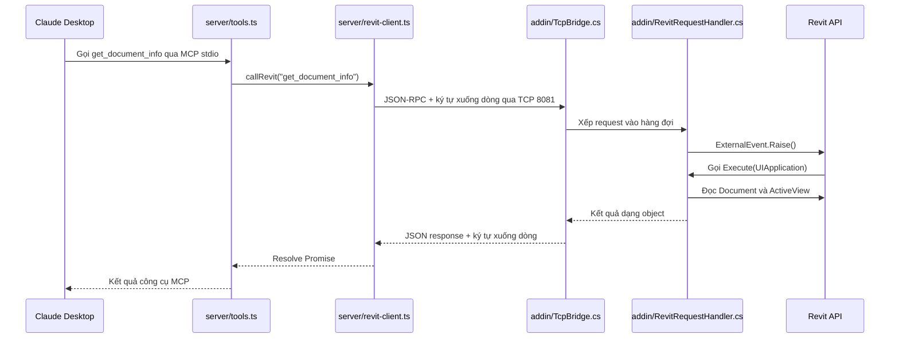

# 02 — Theo dõi một lệnh từ Claude đến Revit



## Đọc mã theo từng bước

1. **Khởi động:** Claude chạy `node server/build/index.js` dựa vào cấu hình MCP. `index.ts` tạo server và gọi `registerTools`.
2. **Khám phá công cụ:** Claude hỏi server có công cụ nào. `tools.ts` đã đăng ký `ping_revit` và `get_document_info`.
3. **Gọi công cụ:** callback trong `tools.ts` gọi `callRevit`. Tên công cụ và tên method được ánh xạ rõ ràng trong file này.
4. **Truyền dữ liệu:** `revit-client.ts` mở socket, tạo ID, gửi một JSON kèm `\n`, rồi chờ kết quả hoặc timeout.
5. **Nhận dữ liệu:** `TcpBridge.cs` đọc đến `\n`, deserialize request, kiểm tra cấu trúc và chuyển đến handler. Socket này chạy ở luồng nền.
6. **Gọi Revit đúng ngữ cảnh:** handler xếp việc vào hàng đợi và báo `ExternalEvent`. Revit tự gọi `Execute` khi có thể xử lý API; việc đọc `Document` chỉ diễn ra ở đây.
7. **Trả kết quả:** kết quả đi ngược về bridge, TCP client và callback MCP. ID phản hồi phải khớp ID request.
8. **Báo lỗi:** lỗi từ Revit có mã JSON-RPC. Callback MCP đặt `isError: true` để Claude nhận biết công cụ thất bại.

## Request nội bộ mẫu

```json
{"jsonrpc":"2.0","id":"example-001","method":"get_document_info","params":{}}
```

Chuỗi trên kết thúc bằng ký tự xuống dòng. ID thực tế được Node.js tạo bằng UUID. Các method trong phiên bản này chưa nhận tham số.

## Response thành công mẫu

```json
{
  "jsonrpc": "2.0",
  "id": "example-001",
  "result": {
    "title": "Mo hinh thu nghiem",
    "path": "",
    "isFamilyDocument": false,
    "isWorkshared": false,
    "activeView": { "id": "12345", "name": "Level 1", "type": "FloorPlan" }
  }
}
```

Đây là dữ liệu minh họa. Khi truyền, JSON được viết trên một dòng rồi thêm `\n`; dấu xuống dòng trong giá trị chuỗi được JSON escape. ID phần tử được trả dưới dạng chuỗi để giữ nguyên giá trị 64-bit khi JavaScript nhận dữ liệu.

## Vì sao cần ExternalEvent?

TCP nhận dữ liệu ở luồng nền, còn Revit API cần ngữ cảnh thực thi do Revit quản lý. Vì vậy `TcpBridge.cs` chỉ xử lý giao tiếp; `RevitRequestHandler.Execute` mới đọc dữ liệu mô hình. Nếu sau này thêm lệnh thay đổi mô hình, mở Transaction trong handler hoặc lớp lệnh mà handler gọi.

## Vì sao JSON kết thúc bằng xuống dòng?

TCP là luồng byte: một JSON có thể đến qua nhiều lần nhận dữ liệu. Ngược lại, một lần nhận có thể chứa nhiều đoạn dữ liệu. Ký tự `\n` cho biết JSON đã kết thúc, giúp hai phía ghép dữ liệu đầy đủ trước khi parse.

Phiên bản đầu dùng một lệnh cho mỗi kết nối để dễ theo dõi. Sau khi nắm rõ luồng này, có thể mở rộng sang kết nối lâu dài với nhiều request có ID riêng.
