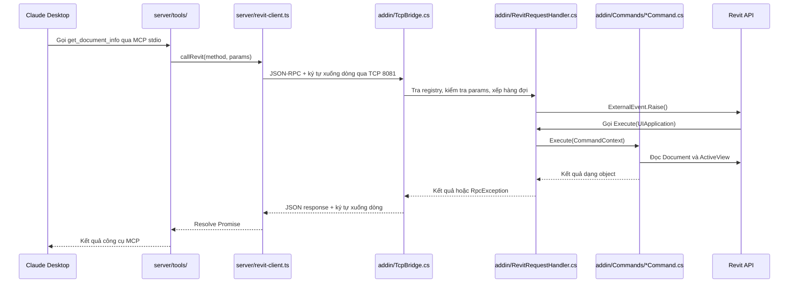

# 02 — Theo dõi một lệnh từ Claude đến Revit



## Đọc mã theo từng bước

1. **Khởi động:** Claude chạy `node server/build/index.js` dựa vào cấu hình MCP. `index.ts` tạo server và gọi `registerTools`.
2. **Khám phá công cụ:** Claude hỏi server có công cụ nào. `tools/index.ts` liệt kê `allTools`; mỗi công cụ có schema tham số và annotations.
3. **Gọi công cụ:** MCP SDK kiểm tra tham số theo schema zod; tham số sai bị từ chối ngay, không gửi đến Revit. Sau đó `tools/define.ts` gọi `callRevit(method, params)`.
4. **Truyền dữ liệu:** `revit-client.ts` mở socket, tạo ID, gửi JSON gồm `method`, `params` và `timeoutMs` kèm `\n`, rồi chờ kết quả.
5. **Nhận dữ liệu:** `TcpBridge.cs` đọc đến `\n`, deserialize request, kiểm tra cấu trúc. Handler tra `CommandRegistry`: method lạ hoặc params không phải object bị báo lỗi ngay trên luồng nền, không chờ Revit.
6. **Gọi Revit đúng ngữ cảnh:** handler xếp việc vào hàng đợi và báo `ExternalEvent`. Revit tự gọi `Execute` khi có thể xử lý API; handler tạo `CommandContext` rồi gọi class command tương ứng. Việc đọc `Document` chỉ diễn ra ở đây.
7. **Trả kết quả:** kết quả đi ngược về bridge, TCP client và callback MCP. ID phản hồi phải khớp ID request.
8. **Báo lỗi:** mọi exception được chuyển thành mã JSON-RPC (xem [bảng mã lỗi](03-add-a-tool.md#mã-lỗi)), kèm `data` nếu có. Callback MCP đặt `isError: true` để Claude nhận biết công cụ thất bại.

## Request nội bộ mẫu

```json
{"jsonrpc":"2.0","id":"example-001","method":"ping","params":{"message":"Xin chào"},"timeoutMs":5000}
```

Chuỗi trên kết thúc bằng ký tự xuống dòng. ID thực tế được Node.js tạo bằng UUID. `params` luôn là object (có thể rỗng). `timeoutMs` không thuộc chuẩn JSON-RPC; đây là trường riêng của dự án.

## Response lỗi mẫu

```json
{"jsonrpc":"2.0","id":"example-002","error":{"code":-32602,"message":"Parameter 'limit': must be between 1 and 500.","data":{"param":"limit"}}}
```

## Response thành công mẫu

```json
{
  "jsonrpc": "2.0",
  "id": "example-001",
  "result": {
    "title": "Mo hinh thu nghiem",
    "path": "",
    "isFamilyDocument": false,
    "isWorkshared": false,
    "isReadOnly": false,
    "activeView": { "id": "12345", "name": "Level 1", "type": "FloorPlan" }
  }
}
```

Đây là dữ liệu minh họa. Khi truyền, JSON được viết trên một dòng rồi thêm `\n`; dấu xuống dòng trong giá trị chuỗi được JSON escape. ID phần tử được trả dưới dạng chuỗi để giữ nguyên giá trị 64-bit khi JavaScript nhận dữ liệu.

## Timeout

Mỗi request mang `timeoutMs`. Giá trị mặc định lấy từ `REVIT_MCP_TIMEOUT_MS` (15000); công cụ có thể tự đặt (`ping_revit` dùng 5000). Add-in giới hạn giá trị trong khoảng 1000–120000 ms.

- Add-in đếm thời gian từ lúc nhận request, gồm cả lúc chờ Revit rảnh. Hết giờ, add-in trả lỗi `-32003`.
- Server chờ thêm 2 giây (`graceMs`) để nhận lỗi `-32003` có cấu trúc, thay vì tự cắt kết nối.
- Request còn trong hàng đợi khi hết giờ sẽ bị bỏ qua. Command đã chạy trong Revit không thể bị dừng giữa chừng, nên command dài phải tự kiểm tra `context.Cancellation`.

## Vì sao cần ExternalEvent?

TCP nhận dữ liệu ở luồng nền, còn Revit API cần ngữ cảnh thực thi do Revit quản lý. Vì vậy `TcpBridge.cs` chỉ xử lý giao tiếp; command chỉ được gọi bên trong `RevitRequestHandler.Execute`. Command thay đổi mô hình sẽ tự mở Transaction trong class của nó.

## Vì sao JSON kết thúc bằng xuống dòng?

TCP là luồng byte: một JSON có thể đến qua nhiều lần nhận dữ liệu. Ngược lại, một lần nhận có thể chứa nhiều đoạn dữ liệu. Ký tự `\n` cho biết JSON đã kết thúc, giúp hai phía ghép dữ liệu đầy đủ trước khi parse.

Phiên bản đầu dùng một lệnh cho mỗi kết nối để dễ theo dõi. Sau khi nắm rõ luồng này, có thể mở rộng sang kết nối lâu dài với nhiều request có ID riêng.
