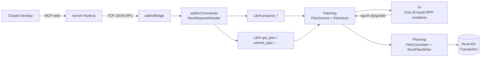
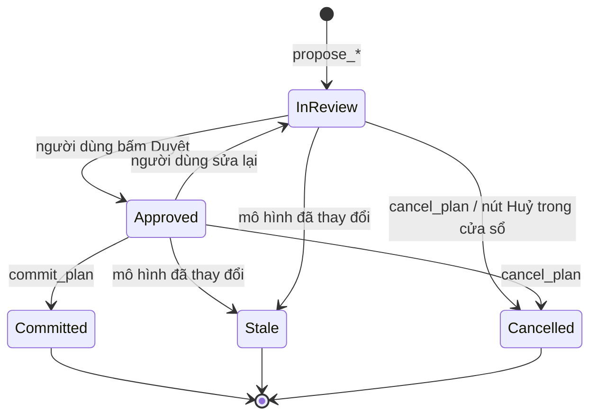
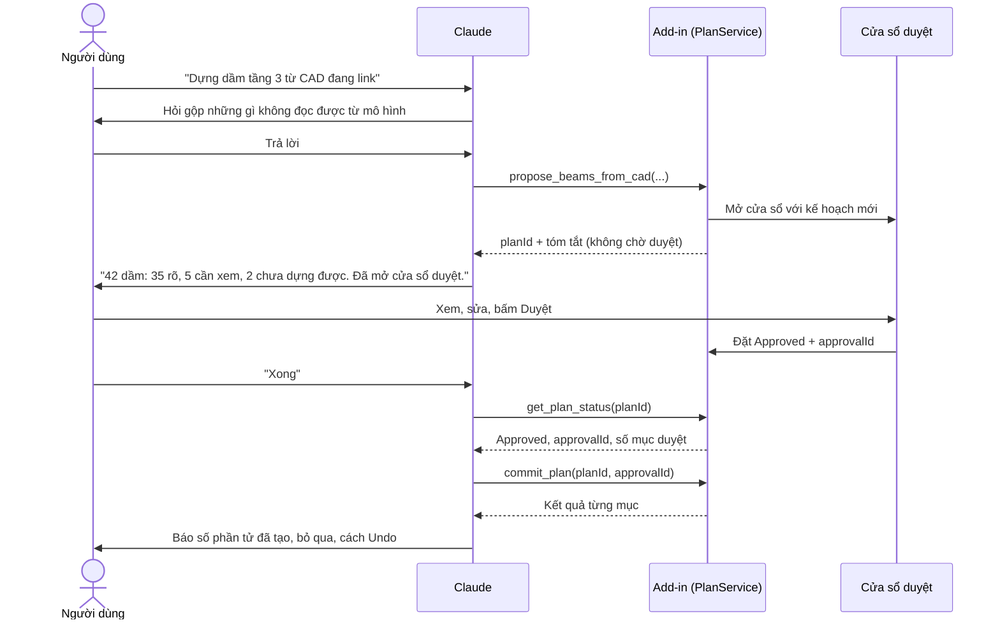

# 04 — Kiến trúc đề xuất và duyệt (propose / approve / commit)

Tài liệu này mô tả kiến trúc cho các công cụ **ghi** vào mô hình, ví dụ dựng móng, cột, dầm từ CAD. Bước 1 của [Lộ trình](#lộ-trình-triển-khai) đã có mã; bước 2 và 3 đã có mã nhưng chưa thử trong Revit thật; các bước sau vẫn là thiết kế.

## Vấn đề cần giải quyết

Bản vẽ đầu vào (thường là CAD import) không phải lúc nào cũng chuẩn: thiếu kích thước, layer lộn xộn, mặt bằng và mặt cắt mâu thuẫn. Claude không thể tự hỏi người thiết kế, nên nếu Claude ghi thẳng vào mô hình thì lỗi của bản vẽ trở thành lỗi của mô hình.

Giải pháp: tách mỗi thao tác ghi thành ba bước, và **chỉ con người mới chuyển được kế hoạch sang trạng thái "đã duyệt"**.

1. **Propose** — Claude yêu cầu add-in lập kế hoạch. Add-in chỉ đọc, không ghi.
2. **Approve** — người dùng xem kế hoạch trong cửa sổ Revit, duyệt, sửa hoặc bỏ từng mục.
3. **Commit** — add-in ghi đúng những mục đã duyệt vào mô hình.

## Chia vai

| Bên | Vai trò | Làm ở đâu |
| --- | --- | --- |
| Người dùng | Quyết định | Chat (nói ý định), cửa sổ Revit (duyệt) |
| Claude | Lập kế hoạch, tóm tắt, giải thích | Chat |
| Cửa sổ duyệt | Hiển thị kế hoạch, chọn và zoom phần tử, cấp phép ghi | Revit |
| Add-in | Giữ kế hoạch, kiểm tra, ghi vào mô hình | Revit |

Nguyên tắc: **chat dùng cho ý định và lý do; Revit dùng cho thứ cần nhìn và duyệt hàng loạt.** Không bắt người dùng trả lời từng dầm một trong khung chat.

## Tổng quan thành phần



Server vẫn mỏng như hiện nay: mỗi tool chỉ khai báo schema rồi gọi `callRevit`. **Toàn bộ logic kế hoạch và quyền ghi nằm trong add-in**, vì chỉ add-in thấy được mô hình và cửa sổ duyệt.

| Thành phần | Thư mục | Nhiệm vụ |
| --- | --- | --- |
| `Plan`, `PlanItem` | `addin/Planning/` | Hợp đồng dữ liệu của kế hoạch |
| `PlanService` | `addin/Planning/` | Tạo, tra cứu, chuyển trạng thái kế hoạch; kiểm tra luật chuyển trạng thái |
| `PlanStore` | `addin/Planning/` | Lưu và đọc kế hoạch dạng JSON |
| `PlanCommitter` | `addin/Planning/` | Luật commit, không dùng Revit: trạng thái, `approvalId`, hash mục đã duyệt, kế hoạch cũ, ghi kết quả và audit |
| `RevitPlanWriter` | `addin/Planning/` | Ghi các mục đã duyệt trong một `TransactionGroup`, mỗi mục một `Transaction` |
| `ModelChangeTracker` | `addin/Planning/` | Đếm `DocumentChanged` theo model trong phiên Revit, tạo `ModelStamp` |
| `ReviewWindow` | `addin/Ui/` | Cửa sổ duyệt WPF modeless |
| `IPlanAction` | `addin/Planning/Actions/` | Cách thực thi một loại mục (tạo dầm, đặt móng, gán parameter…) |
| Lệnh `propose_*` | `addin/Commands/<Nhóm>/` | Đọc dữ liệu, lập danh sách mục, gửi cho `PlanService` |
| Tool chung | `server/src/tools/plans.ts` | `get_plan`, `get_plan_status`, `open_plan_review`, `commit_plan`, `cancel_plan` |
| Chờ duyệt | `server/src/tools/wait.ts` | `wait_for_plan` (chỉ có ở server, dựa trên `get_plan_status`) |

Mỗi loại công việc mới (cột, dầm, móng…) chỉ cần thêm **một lệnh `propose_*`** và **các `IPlanAction`** của nó. Phần khung dùng chung.

Sửa phần tử **đã có** cũng đi qua khung này, không cần `send_code`:

| Lệnh | Action | Mỗi mục là |
| --- | --- | --- |
| `propose_set_parameters` | `set_parameter` | một phần tử: parameter cũ → giá trị mới |
| `propose_change_type` | `change_type` | một Type hiện tại → Type đích, kèm số phần tử, vd `Walls · CW 102-85-100p → BTC-VachKC_300 (14)`. Phần tử khác category với Type đích bị từ chối ngay lúc propose, phần tử đã đúng Type bị bỏ qua; lúc commit `ChangeTypeId` từng phần tử trong Transaction của mục, nên vẫn là một Ctrl+Z cùng các mục khác |

## Hợp đồng dữ liệu

### Plan

```json
{
  "planId": "pln_20261014_8f3a2c",
  "kind": "create_beams",
  "title": "Dựng dầm tầng 3 từ CAD S-301",
  "createdAt": "2026-10-14T09:12:00Z",
  "document": { "title": "DuAn_KetCau", "path": "D:\\DuAn\\DuAn_KetCau.rvt" },
  "scope": { "level": "Level 3", "source": "S-301.dwg" },
  "modelStamp": { "sessionId": "c1d2…", "changeCounter": 418 },
  "status": "InReview",
  "approval": null,
  "summary": { "total": 42, "approved": 0, "rejected": 0, "pending": 42 },
  "items": [ "..." ],
  "questions": [ "..." ]
}
```

### PlanItem

```json
{
  "itemId": "B12",
  "action": "create_beam",
  "params": {
    "familyType": "Dầm BTCT 300x600",
    "start": [12000, 4500, 0],
    "end": [18000, 4500, 0],
    "level": "Level 3",
    "zOffsetMm": 0
  },
  "confidence": 0.62,
  "tier": "review",
  "reasons": ["Điểm cuối hở 80 mm so với cột C7", "Nhãn \"D3 300x600\" cách dầm 1,2 m"],
  "source": { "file": "S-301.dwg", "layer": "S-BEAM", "handle": "2F1A" },
  "status": "Pending",
  "overrides": null,
  "result": null
}
```

- `confidence` (0..1) và `tier`, trên **một thang tin cậy chung** (`addin/Recognition/Evidence.cs`):
  - Mỗi ứng viên (cột, vách, cọc, đài, dầm) **bắt đầu từ 50%**: chưa có bằng chứng nào thuận hay nghịch.
  - Bằng chứng cộng trừ theo trọng số: quan hệ kết cấu mạnh ±20% (giao trục, cọc trong đài, gối bên dưới, hatch, dầm tựa hai đầu), bằng chứng phụ ±10% (kích thước lặp, ký hiệu, chia đều nhịp, nét khuất), tên layer ±5% (chỉ là gợi ý). Lý do ghi dạng `+20% ở giao trục`.
  - **Loại trừ là phủ quyết**, không phải điểm trừ (`loại trừ: …`): mảnh vách bị cửa cắt, ký hiệu lỗ mở sàn, đài bao lấy đài khác, dầm phụ to hơn dầm gối bị giữ tối đa **40%** (luôn phải xem); đường bao cột vẽ trong đài và dải tường mảnh bị giữ ở 10% (bỏ). Vòng tròn đầu trục −60%.
  - **≥ 50%: tự duyệt** (`PlanConfidence.AutoApproveFrom`, `tier: "auto"`, bắt đầu ở trạng thái "Tự duyệt"); 20–50%: cần xem (nhóm `-maybe` riêng, để một phần tử nghi ngờ không giữ lại cả nhóm); dưới 20%: bỏ, chỉ báo số lượng và lý do.
  - Một mục duyệt chứa cả nhóm, nên **bằng phần tử kém chắc nhất** (`ConfidenceRules.Group`). Mục sắp **tạo Type mới**, hay ký hiệu và hình vẽ lệch nhau, luôn phải xem (giữ dưới 50%). Dầm chính: 50% +20% hai gối +10% kích thước từ ký hiệu, −10% mỗi điều lệch (mượn ký hiệu, lệch bề rộng, nét đứt, không trên trục). Trục: theo `GridRecognizer`. Sàn, tầng, đặt tham số: chưa có luật, luôn phải duyệt.
  - **Kế thừa quyết định tầng dưới** (`PlanHistory`): cột trùng vị trí và kích thước với cột người dùng đã **bỏ** ở các kế hoạch cột đã ghi của tầng dưới (top level = base level tầng này; kế hoạch sau thắng kế hoạch trước, nên vị trí đã dựng bù không còn bị bỏ) được gom thành mục riêng `K-<nhóm>-tangduoibo`, `tier: "auto"`, bắt đầu ở trạng thái **"Tự bỏ"** (`autoStatus: "Rejected"`). Người dùng vẫn có thể chọn Duyệt. Danh sách chính chỉ có mục cần người dùng xem; mục tự duyệt và tự bỏ nằm trong hai phần thu gọn "N nhóm được hệ thống tự động duyệt / bỏ qua", mở ra khi muốn xem; mục nào người dùng đổi trạng thái thì về danh sách chính.
  - **Ghi ngay khi duyệt** (Settings, "Bấm Duyệt kế hoạch là ghi vào mô hình ngay", mặc định **bật**): bấm Duyệt kế hoạch thì cửa sổ duyệt gọi chính `commit_plan` (`CommitHandler`, qua ExternalEvent) nên vẫn đủ các luật: approvalId mới nhất, mô hình chưa đổi từ lúc đề xuất, chế độ chỉ đọc, lệnh `commit_plan` đang bật. Kết quả hiện ở dòng thông báo của cửa sổ. Claude đọc `get_plan_status` thấy `Committed` thì làm bước tiếp; gọi lại `commit_plan` chỉ trả kết quả cũ.
  - **Tự commit** (BIMTECH MCP Settings, "Tự commit kế hoạch khi mọi mục đủ tin cậy", mặc định tắt): khi bật, kế hoạch mà **mọi mục đều đã được quyết thay** (tự duyệt hoặc tự bỏ, ít nhất một mục duyệt) và không có mục bị chặn được duyệt thay người dùng ngay khi đề xuất (`approval.automatic`, kết quả có `autoApproved: true`), không mở cửa sổ duyệt; Claude gọi `commit_plan` luôn. Quyền này thuộc cài đặt người dùng bật trong Revit; không lệnh JSON-RPC nào tự duyệt (test hợp đồng vẫn kiểm).
- `tier` có ba giá trị: `auto` (được ghi không cần duyệt từng mục), `review` (cần duyệt), `blocked` (không được ghi; chuyển thành câu hỏi cho thiết kế).
- `overrides` chứa giá trị người dùng sửa trong cửa sổ duyệt; khi commit, `overrides` được gộp đè lên `params`.
- `result` sau khi commit chứa ID phần tử Revit đã tạo, hoặc thông báo lỗi.

### Question

```json
{
  "questionId": "Q3",
  "itemIds": ["B12", "B13"],
  "text": "Dầm trục 4 giữa B–C: mặt bằng ghi 300x600, mặt cắt 2-2 ghi 300x700. Kích thước đúng là bao nhiêu?",
  "status": "Open",
  "answer": null
}
```

Câu hỏi được Claude dùng để soạn tin nhắn gửi bên thiết kế. Khi có câu trả lời, người dùng dán vào chat và Claude cập nhật kế hoạch (giai đoạn sau).

## Vòng đời kế hoạch



Trạng thái từng mục: `Pending → Approved | Rejected`, sau commit thành `Applied | Failed`. Mục `Rejected` không bao giờ được ghi.

Luật duyệt (trong `PlanService`):

- Người duyệt đặt mục thành `Approved`, `Rejected`, hoặc trả về `Pending` để làm lại. Mục `blocked` không duyệt được.
- Sửa một mục khi kế hoạch đang `Approved` sẽ đưa kế hoạch về `InReview` và xoá `approval`, nên `approvalId` cũ hết hiệu lực. Đặt lại đúng trạng thái cũ thì không tính là sửa.
- **Duyệt kế hoạch** chỉ được khi mọi mục không phải `blocked` đã có quyết định và có ít nhất một mục `Approved`. Mục chưa quyết định không bị ngầm coi là bỏ.
- Khi duyệt, `approval` chứa `approvalId` (dạng `apr_` + 16 ký tự hex), `approvedAt`, `approvedItemIds` và `itemsHash` (SHA-256 của mã, action, params, overrides các mục đã duyệt; bước 3 tính lại để chắc chắn ghi đúng bản đã duyệt).
- Huỷ hoặc kế hoạch cũ (`Stale`) xoá `approval`; `Committed` giữ lại làm hồ sơ.

## Bốn nguyên tắc bắt buộc

1. **Propose là thuần đọc.** Lệnh `propose_*` không mở Transaction. Nếu cần tính toán hình học thử, dùng dữ liệu trong bộ nhớ, không tạo phần tử tạm trong mô hình.
2. **Chỉ cửa sổ duyệt mới đưa kế hoạch sang `Approved`.** Không có lệnh JSON-RPC nào làm được việc này. Khi người dùng bấm Duyệt, add-in tạo một `approvalId` ngẫu nhiên gắn với ảnh chụp (snapshot) danh sách mục đã duyệt. `commit_plan` phải gửi đúng `approvalId` mới nhất; nếu người dùng sửa lại sau khi duyệt, `approvalId` cũ hết hiệu lực.
3. **Phát hiện kế hoạch cũ.** Add-in đếm sự kiện `DocumentChanged` của từng model trong phiên Revit (`ModelChangeTracker`, đăng ký ngay khi Revit khởi động). Propose lưu `modelStamp` (`sessionId`, `changeCounter`). Khi commit, nếu bộ đếm khác lúc propose hoặc khác phiên Revit, kế hoạch thành `Stale` và phải propose lại. **Mọi** thay đổi đều tính, kể cả Undo, add-in khác và commit của kế hoạch khác: các mục được kiểm tra trên mô hình lúc propose, nên mô hình đổi thì không còn bảo đảm. Kế hoạch tạo trước khi có `modelStamp` (schema 1–2) luôn coi là cũ.
4. **Commit gom trong một `TransactionGroup`.** Người dùng hoàn tác bằng một lần Undo. Bên trong, mỗi mục chạy trong một `Transaction` riêng: mục lỗi chỉ rollback chính nó thành `Failed`, các mục khác vẫn ghi. Cảnh báo Revit được ghi vào `result.warnings` và bỏ qua; lỗi Revit rollback mục đó; không có hộp thoại nào hiện ra. Mỗi mục ghi `result` sau khi chạy, nên gọi `commit_plan` lần hai trên kế hoạch đã `Committed` chỉ trả lại kết quả cũ, không tạo trùng.

   Trước khi ghi, commit tính lại `itemsHash` của các mục đã duyệt; nếu khác bản lúc duyệt (ví dụ file kế hoạch bị sửa tay) thì từ chối với `-32023`. Sau khi ghi, add-in nối một dòng vào `audit.jsonl` cạnh các file kế hoạch: thời điểm, `planId`, `approvalId`, người dùng Windows, số mục ghi được và lỗi.

## Luồng một lượt làm việc



Điểm quan trọng: `propose_*` **trả về ngay**, không chờ người dùng duyệt. Nếu chờ, kết nối TCP phải mở hàng phút và vượt timeout tối đa 120000 ms (xem [02 — Timeout](02-request-flow.md#timeout)). Để người dùng không phải quay lại chat báo "xong", Claude gọi **`wait_for_plan`** ngay sau khi đề xuất: tool này nằm ở server Node, hỏi `get_plan_status` mỗi 2 giây (`REVIT_MCP_WAIT_POLL_MS`) và gửi thông báo tiến độ để client không hết hạn chờ. Việc chờ không đi qua luồng chính của Revit, nên Revit vẫn dùng bình thường. Tool trả kết quả khi kế hoạch `Committed` (cửa sổ đã ghi: Claude làm bước tiếp), `Approved` quá 10 giây mà chưa ghi (đã tắt "ghi ngay khi duyệt": Claude gọi `commit_plan`), `Cancelled` hoặc `Stale` (dừng và báo), hoặc hết `timeoutSeconds` (mặc định 900). Mục bị chặn vẫn cần người dùng trả lời trong chat.

## Công cụ MCP

| Tool | Loại | Mô tả |
| --- | --- | --- |
| `propose_*` | đọc | Lập kế hoạch cho một loại việc; mở cửa sổ duyệt; trả `planId` và tóm tắt |
| `get_plan` | đọc | Đọc kế hoạch; lọc theo `status`, `tier` hoặc `itemIds`; có phân trang. Dùng để trả lời câu hỏi "vì sao mục B12 bị nghi ngờ?" bằng `reasons` thật |
| `get_plan_status` | đọc | Trạng thái, `approvalId` (nếu đã duyệt) và tóm tắt số lượng; nhẹ, gọi nhiều lần được |
| `open_plan_review` | đọc | Mở lại cửa sổ duyệt của một kế hoạch |
| `commit_plan` | ghi | Nhận `planId` và `approvalId`; ghi các mục đã duyệt |
| `cancel_plan` | ghi (chỉ kế hoạch) | Huỷ kế hoạch; không chạm vào mô hình |

Annotations theo [03](03-add-a-tool.md#1-phía-server): `commit_plan` có `readOnlyHint: false`, `destructiveHint: true` (vì kế hoạch có thể chứa mục xoá hoặc ghi đè). `propose_*` và `open_plan_review` không sửa mô hình nên có `readOnlyHint: true`, dù chúng mở cửa sổ.

## Cửa sổ duyệt

- **WPF modeless**: không khoá Revit, người dùng vẫn chọn, zoom, xoay mô hình khi cửa sổ đang mở.
- Mở và cập nhật cửa sổ trên luồng giao diện của Revit (gọi từ trong `RevitRequestHandler.Execute`). Thao tác cần Revit API từ cửa sổ (chọn và zoom phần tử) đi qua một `ExternalEvent` riêng của cửa sổ.
- Giao diện tối, theo thẻ: tiêu đề kế hoạch và nhãn trạng thái (Chưa thực thi / Đã ghi / Đã huỷ / Đã cũ); ba thẻ số **Đã chọn tạo**, **Bỏ qua**, **Cần xem**; danh sách **Cần bạn xem (n)** (chỉ mục chưa được hệ thống tự quyết); các phần thu gọn: tự động duyệt, tự động bỏ qua, câu hỏi cho thiết kế; thẻ **Kết quả sẽ áp dụng** ("Tạo 50 cột (4 nhóm) trong mô hình Revit. Bỏ qua 21 nhóm còn lại.") và lời nhắc còn mấy mục cần xem.
- Mỗi dòng là một mục: dấu tròn bấm để duyệt hoặc bỏ qua, phần tử và thay đổi, độ tin cậy, trạng thái (Đã duyệt, Tự duyệt, Cần xem, Bỏ qua, Tự bỏ, Đã ghi, Lỗi), hành động (Tạo cột...). Chọn một dòng thì lý do và chi tiết (vd. code của `send_code`) hiện bên dưới danh sách. Bấm vào dòng thì Revit chọn và zoom tới vị trí tương ứng (phần tử đã có, hoặc vùng toạ độ của phần tử sẽ tạo).
- **Xem trước mục sẽ tạo**: khi chọn dòng `create_*` (cột, dầm, tường, đài cọc, sàn, trục), Revit vẽ tạm bằng nét cam vị trí các phần tử chưa có rồi zoom tới đó — đài cọc: đường bao và vòng tròn từng cọc; nhóm cột: hình chữ nhật từng cột; nhóm dầm, tường, trục: đường trục. Hình vẽ chỉ nằm trong đồ hoạ (`PreviewServer`, một server DirectContext3D), không ghi vào mô hình, không mở Transaction. Mặt bằng vẽ ở cao độ mặt cắt của khung nhìn, 3D vẽ ở cao độ level của mục. Hình biến mất khi đổi dòng chọn, đóng cửa sổ hoặc đóng mô hình. Đọc toạ độ từ `params` nằm ở `PreviewShapes` (không dùng Revit, có kiểm thử).
- Thao tác: dấu tròn từng dòng, **Duyệt tất cả** / **Bỏ duyệt tất cả** (trên danh sách cần xem, không đụng mục hệ thống tự quyết), **Khôi phục lựa chọn** (về đúng đề xuất ban đầu), nút chính **Duyệt và ghi (n)** (hoặc **Duyệt kế hoạch (n)** khi tắt ghi ngay), **Huỷ kế hoạch**. Nút chính chỉ bật khi không còn mục cần xem. Sửa giá trị (`overrides`) để sang bước 2b.
- Đóng cửa sổ **không** huỷ kế hoạch; mở lại bằng `open_plan_review`. Như vậy lỡ tay đóng thì không mất công duyệt.
- Mục `blocked` hiển thị riêng ở phần thu gọn **câu hỏi cho thiết kế**, không duyệt được.

## Lưu trữ

Đã chốt: **file JSON**, mỗi kế hoạch một file.

- Mô hình đã lưu, thư mục ghi được: `<thư mục model>\<tên model>_bimtech\plans\<planId>.json`.
- Mô hình chưa lưu, mô hình cloud, hoặc thư mục chỉ đọc: `%LOCALAPPDATA%\Bimtech.RevitMcp\plans\<mã tài liệu>\<planId>.json`.
- Với mô hình workshared, dùng đường dẫn bản local của người dùng, không ghi cạnh file central trên máy chủ.

JSON dễ mở để xem, dễ sao chép và dễ đọc lại khi kiểm tra lỗi. `PlanStore` là một interface, nên sau này có thể đổi sang Extensible Storage mà không sửa phần còn lại.

## Mức bảo mật

Đã chốt: **token ngẫu nhiên đơn giản** cho giai đoạn đầu.

- Bảo vệ chính nằm ở nguyên tắc 2: không có lệnh JSON-RPC nào đặt kế hoạch thành `Approved`. `approvalId` đảm bảo Claude commit đúng phiên bản người dùng đã duyệt.
- Cầu nối TCP chỉ nghe `127.0.0.1`. Giai đoạn đầu chấp nhận rủi ro một tiến trình khác trên cùng máy gọi `commit_plan` sau khi người dùng đã duyệt.
- Nếu dùng trên máy dùng chung hoặc cần chặt hơn, thêm bước bắt tay bằng khoá bí mật giữa server và add-in (HMAC). Việc này nằm ở tầng cầu nối, không ảnh hưởng thiết kế kế hoạch.

## Mã lỗi mới

Tiếp nối [bảng mã lỗi](03-add-a-tool.md#mã-lỗi):

| Mã | Ý nghĩa |
| --- | --- |
| `-32020` | Không tìm thấy kế hoạch (`data.planId`) |
| `-32021` | Trạng thái kế hoạch không cho phép thao tác này, ví dụ commit khi chưa duyệt hoặc huỷ kế hoạch đã huỷ (`data.status`, `data.target`) |
| `-32022` | Kế hoạch đã cũ vì mô hình thay đổi; cần propose lại |
| `-32023` | `approvalId` không khớp lần duyệt mới nhất |

## Lộ trình triển khai

Mỗi bước kết thúc bằng một phiên bản chạy được và kiểm thử được.

1. **Lõi kế hoạch** *(đã làm)*. `Plan`, `PlanItem`, `PlanService` với luật chuyển trạng thái, `PlanStore` JSON; tool `get_plan`, `get_plan_status`, `cancel_plan`; mã lỗi mới. Kèm một lệnh mẫu đơn giản, `propose_set_parameters` (gán giá trị parameter cho các phần tử đang chọn), để thử trọn luồng mà chưa cần CAD. Chưa có `modelStamp`; phát hiện kế hoạch cũ thuộc bước 3.
2. **Cửa sổ duyệt** *(đã làm, chờ thử trong Revit)*. `Plan.Approval`, `PlanService.SetItemStatus` / `Approve`, sự kiện `Changed`; cửa sổ WPF modeless trong `addin/Ui/` (một cửa sổ dùng chung, đóng theo model, chọn và zoom qua `FocusHandler`); `propose_set_parameters` tự mở cửa sổ; tool `open_plan_review`. Kiểm thử xUnit cho luật duyệt và ViewModel, kiểm thử bảo đảm không command nào gọi `Approve`.
   2b. Sửa giá trị (`overrides`) trong cửa sổ.
3. **Ghi vào mô hình** *(đã làm, chờ thử trong Revit)*. `PlanCommitter` (luật commit, kiểm thử xUnit với writer giả), `RevitPlanWriter`, `IPlanAction` + `SetParameterAction`, `ModelChangeTracker` và `Plan.ModelStamp` (schema 3), nhật ký `audit.jsonl`; tool `commit_plan`.
4. **Gắn tool móng, cột, dầm hiện có** vào khung: tách phần tính toán thành `propose_*`, phần tạo phần tử thành `IPlanAction`. Thêm `propose_change_type` (action `change_type`) để sửa Type phần tử đã dựng qua cửa sổ duyệt thay cho `send_code`.
5. **Độ tin cậy.** CAD preflight, luật chấm điểm theo từng mục, chính sách ngưỡng theo loại việc (để sau; xem phần dưới).
6. **Vòng phản hồi với thiết kế.** Câu hỏi, xuất danh sách câu hỏi, ghi nhớ quyết định theo dự án.

## Chưa làm ở giai đoạn này

- **Chấm điểm độ tin cậy** (CAD preflight, luật cho dầm, trần độ tin cậy cho sàn). Kiến trúc đã để sẵn `confidence`, `tier`, `reasons` và `questions`; luật cụ thể sẽ thiết kế ở bước 5.
- **Tự ghi mục `auto`** mà không cần duyệt. Cho đến khi có luật chấm điểm đáng tin, mọi mục đều phải duyệt.
- **Elicitation của MCP** (server hỏi lại người dùng qua Claude Desktop). Cửa sổ trong Revit chắc chắn hơn và cho thấy phần tử ngay trên mô hình.
