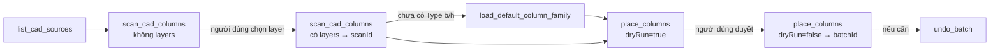

# 04 — Dựng model kết cấu từ CAD

Mục tiêu: Claude dựng cột, dầm, vách, sàn, cọc từ bản vẽ CAD đã import/link vào Revit, có người duyệt trước mỗi lần ghi. Bản hiện tại làm xong **cột**; các loại còn lại theo cùng khuôn.

## Lõi dùng chung

Thuật toán quét CAD và đặt phần tử nằm ở repo `RevitAddinManager`, thư mục `Tools/_Shared/StructuralCore/`. Lõi được dùng chung với các hot tool WPF (`Tools/Modeling/Place*`), nên sửa thuật toán ở một chỗ thì cả hai được hưởng.

- Add-in MCP **biên dịch thẳng** các file `.cs` của lõi vào DLL qua `StructuralCore.props`, không tham chiếu DLL riêng.
- `addin/Bimtech.RevitMcp.Addin.csproj` tìm lõi ở `..\..\RevitAddinManager\Tools\_Shared\StructuralCore\`. Nếu đặt repo ở chỗ khác: `dotnet build ... -p:StructuralCoreDir=<đường dẫn>\`.
- `StructuralCoreEmbedFamilies=true` nhúng các family chuẩn (`Families/*.rfa`) vào DLL MCP.

| Thành phần lõi | Vai trò |
| --- | --- |
| `Cad/CadGeometry` | Hình chữ nhật xoay nhỏ nhất, convex hull, tên layer, vùng chữ nhật |
| `Columns/ColumnScanner` | Đọc đường bao cột theo layer từ một ImportInstance |
| `Columns/ColumnPlacer` | Gom nhóm theo kích thước, xem trước và thực hiện đặt cột / tạo Type |
| `Columns/ColumnTypeMatcher` | Khớp Type theo tham số b/h |
| `Families/DefaultFamilies` | Nạp family chuẩn công ty từ tài nguyên nhúng |

## Quy trình (cột)

1. `list_cad_sources`: ID các CAD trong model. CAD gắn riêng một view (`viewSpecific`) sẽ được quét trong view đó.
2. `scan_cad_columns` lần 1 (không `layers`): các layer có đường bao chữ nhật kèm số lượng. Claude hỏi người dùng layer nào là cột.
3. `scan_cad_columns` lần 2 (có `layers`): nhóm theo kích thước (khóa như `"1400x350"`, cạnh lớn trước), Type khớp đúng (`exactType`) hoặc gần nhất (`nearestType`), và `scanId`. Hình học ở lại trong add-in.
4. Nếu model chưa có Type cột nào có tham số b/h: `load_default_column_family` nạp `BTC-CotCN_BeTong` và trả `familyId`.
5. `place_columns` với `dryRun=true` (mặc định): kế hoạch theo nhóm gồm Type dùng, Type sẽ tạo, số cột tạo, số cột trùng. Không sửa model.
6. Người dùng duyệt → `place_columns` với `dryRun=false`: tạo Type thiếu + đặt cột trong **một TransactionGroup** (một lần Ctrl+Z), trả `batchId`.
7. `undo_batch`: xóa đúng những gì batch đã tạo.

Type cho mỗi nhóm được chọn theo thứ tự: mục trong `types` → Type có sẵn khớp b/h → Type mới tạo trong `templateFamilyId` → chưa có Type. Lần chạy thật **từ chối bắt đầu** khi còn nhóm chưa có Type.

## An toàn khi ghi

| Cơ chế | Tác dụng |
| --- | --- |
| `dryRun` mặc định `true` | Muốn sửa model phải gọi rõ `dryRun=false`; mô tả công cụ yêu cầu Claude hỏi người dùng trước |
| `RequireWritableDocument()` | Từ chối family document, model chỉ đọc, hoặc khi Revit đang trong transaction khác (`-32006`) |
| `FailureGuard` | Cảnh báo Revit được ghi lại và bỏ qua; lỗi thì rollback và báo về — không có hộp thoại nào làm treo bridge |
| `TransactionGroup` | Mỗi lần ghi là một bước Undo; lỗi giữa chừng thì rollback toàn bộ |
| Chống trùng | Vị trí đã có cột cùng family, cùng khoảng cao độ, bị bỏ qua; chạy lại không tạo cột đôi |
| Giới hạn | Tối đa 5000 cột mỗi lần gọi |
| `undo_batch` | Không xóa Type/family còn được dùng; phần giữ lại vẫn gỡ được sau bằng cùng `batchId` |

`scanId` và `batchId` chỉ sống trong bộ nhớ của bridge (tối đa 20 mỗi loại) và gắn với document đã tạo ra chúng. Tắt bridge thì mất; khi đó dùng Ctrl+Z trong Revit.

## Thêm loại phần tử mới (dầm, vách, sàn, cọc)

1. Chuyển scanner/placer của tool WPF tương ứng vào `StructuralCore/<Loại>/`, giữ nguyên thuật toán, bỏ phụ thuộc UI. Thêm hàm `Plan*` xem trước cho mỗi thao tác ghi.
2. Cho tool WPF dùng lõi, build bằng `publish-tool.ps1 -NoUpload`, test hồi quy trong Revit.
3. Thêm `Scan<Loại>Command` và `Place<Loại>Command` trong `addin/Commands/Structural/` theo mẫu cột: kết quả quét lưu bằng `context.Sessions.Add`, lần chạy thật dùng `FailureGuard` + `TransactionGroup` + `WriteBatch`.
4. Khai báo công cụ trong `server/src/tools/structural.ts`; `tests/contract.test.mjs` kiểm tra hai phía khớp tên.
