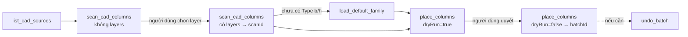

# 05 — Dựng model kết cấu từ CAD

Mục tiêu: Claude dựng cột, dầm, vách, sàn, cọc từ bản vẽ CAD đã import/link vào Revit, có người duyệt trước mỗi lần ghi. Đã có **cột, dầm, cọc + đài**; vách và sàn theo cùng khuôn.

## Lõi kết cấu

Thuật toán quét CAD và đặt phần tử nằm trong `addin/StructuralCore/`. Lõi được chép từ repo `RevitAddinManager` (`Tools/_Shared/StructuralCore/`, commit `f2db0d5`) và từ nay được duy trì riêng ở đây. Các hot tool WPF bên `RevitAddinManager` giữ bản của chúng, nên sửa lõi ở repo này không ảnh hưởng tới chúng và ngược lại.

- Các file `.cs` của lõi được **biên dịch thẳng** vào DLL add-in, không tham chiếu DLL riêng.
- Các family chuẩn (`StructuralCore/Families/*.rfa`) được nhúng vào DLL dưới tên tài nguyên `Bimtech.StructuralCore.Families.<tên file>`.

| Thành phần lõi | Vai trò |
| --- | --- |
| `Cad/CadGeometry` | Hình chữ nhật xoay nhỏ nhất, convex hull, tên layer, vùng chữ nhật |
| `Columns/ColumnScanner` | Đọc đường bao cột theo layer từ một ImportInstance |
| `Columns/ColumnPlacer` | Gom nhóm theo kích thước, xem trước và thực hiện đặt cột / tạo Type |
| `Columns/ColumnTypeMatcher` | Khớp Type theo tham số b/h |
| `Beams/` | Ghép cặp line thành dầm, sửa line mồ côi, đọc tag từ Text, nối dầm tới cột, gom nhóm, xem trước + đặt |
| `Piles/` | Quét circle/đường bao, gán cọc vào đài, gom nhóm đường kính, xem trước + đặt cọc/đài, lớp lót, bắt tròn theo lưới, join (`PileWorkflow`) |
| `Common/PlacementModels` | Kết quả đặt dùng chung, đọc tham số kích thước của Type |
| `Families/DefaultFamilies` | Nạp family chuẩn công ty (cột, dầm, cọc) từ tài nguyên nhúng |

## Quy trình (cột)

1. `list_cad_sources`: ID các CAD trong model. CAD gắn riêng một view (`viewSpecific`) sẽ được quét trong view đó.
2. `scan_cad_columns` lần 1 (không `layers`): các layer có đường bao chữ nhật kèm số lượng. Claude hỏi người dùng layer nào là cột.
3. `scan_cad_columns` lần 2 (có `layers`): nhóm theo kích thước (khóa như `"1400x350"`, cạnh lớn trước), Type khớp đúng (`exactType`) hoặc gần nhất (`nearestType`), và `scanId`. Hình học ở lại trong add-in.
4. Nếu model chưa có Type cột nào có tham số b/h: `load_default_family` với `kind=column` nạp `BTC-CotCN_BeTong` và trả `familyId`.
5. `place_columns` với `dryRun=true` (mặc định): kế hoạch theo nhóm gồm Type dùng, Type sẽ tạo, số cột tạo, số cột trùng. Không sửa model.
6. Người dùng duyệt → `place_columns` với `dryRun=false`: tạo Type thiếu + đặt cột trong **một TransactionGroup** (một lần Ctrl+Z), trả `batchId`.
7. `undo_batch`: xóa đúng những gì batch đã tạo.

Type cho mỗi nhóm được chọn theo thứ tự: mục trong `types` → Type có sẵn khớp b/h → Type mới tạo trong `templateFamilyId` → chưa có Type. Lần chạy thật **từ chối bắt đầu** khi còn nhóm chưa có Type.

## Dầm

`scan_cad_beams` → `place_beams`, cùng khuôn với cột. Khác biệt:

- Dầm là cặp line song song; tên và kích thước đọc từ Text Note gần tim dầm (`"D2-X7(220x600)"`, khoảng tìm `textSearchMm`, mặc định 1000).
- Ba loại nhóm: theo **tên** (khóa = tên dầm, mặc định được đặt), theo **b×h** từ Text không tên (`"220x600"`), chỉ theo **bề rộng** (`"b220"`). Hai loại sau chỉ đặt khi có trong `include`; nhóm chỉ có bề rộng luôn cần Type trong `types` vì không biết h.
- `extendToColumns` + `levelId`: kéo đầu dầm tới cột gần nhất (`columnSearchMm`, mặc định 3000).
- Chống trùng tính cả dầm vừa đặt trong cùng lượt.
- Type mới tạo trong `templateFamilyId` (`load_default_family kind=beam` cho `BTC-DamCN_BeTong`); nhiều nhóm cùng b×h dùng chung 1 Type.

## Cọc và đài

`scan_cad_piles` → `place_piles`, chạy đúng chuỗi của nút "Đặt" trong tool WPF (`PileWorkflow.PlaceAll`):

1. Đặt cọc + đài. Đài là Foundation Slab trên `capLevelId`; đỉnh cọc = cao độ level − chiều dày đài; cọc ngoài mọi đài không đặt được.
2. Lớp lót dưới mỗi đài (`withLot`, mặc định có, lệch `lotOffsetMm` = 50).
3. Bắt tròn kích thước theo lưới trục trong view của CAD.
4. Join cọc với đài.

`load_default_family kind=pile` nạp `BTC-CocTron_BeTong` và tạo `BTC-DaiMong_1500` / `BTC-BeTongLot_100` khi chưa có (cần sẵn ít nhất 1 Type Foundation Slab làm mẫu). Type cọc thiếu chỉ được tạo khi `createMissingTypes=true`, nhân bản từ Type gần nhất, tên theo đường kính.

## An toàn khi ghi

| Cơ chế | Tác dụng |
| --- | --- |
| `dryRun` mặc định `true` | Muốn sửa model phải gọi rõ `dryRun=false`; mô tả công cụ yêu cầu Claude hỏi người dùng trước |
| `RequireWritableDocument()` | Từ chối family document, model chỉ đọc, hoặc khi Revit đang trong transaction khác (`-32006`) |
| `FailureGuard` | Cảnh báo Revit được ghi lại và bỏ qua; lỗi thì rollback và báo về — không có hộp thoại nào làm treo bridge |
| `TransactionGroup` | Mỗi lần ghi là một bước Undo; lỗi giữa chừng thì rollback toàn bộ |
| Chống trùng | Vị trí đã có cột cùng family, cùng khoảng cao độ, bị bỏ qua; chạy lại không tạo cột đôi |
| Giới hạn | Tối đa 5000 cột mỗi lần gọi |
| `undo_batch` | Không xóa Type/family còn được dùng (kể cả Type sàn móng); phần giữ lại vẫn gỡ được sau bằng cùng `batchId` |
| `WriteSession` | Khung chung của mọi lệnh ghi: FailureGuard + TransactionGroup + lưu batch |

`scanId` và `batchId` chỉ sống trong bộ nhớ của bridge (tối đa 20 mỗi loại) và gắn với document đã tạo ra chúng. Tắt bridge thì mất; khi đó dùng Ctrl+Z trong Revit.

## Thêm loại phần tử mới

Lõi đã có sẵn level/lưới (`Levels/`), vách (`Walls/`) và sàn (`Floors/`); chưa có command MCP cho chúng.

1. Nếu lõi chưa có loại đó: viết scanner/placer trong `addin/StructuralCore/<Loại>/`, không phụ thuộc UI (có thể tham khảo tool WPF bên `RevitAddinManager` nhưng không sửa repo đó). Thêm hàm `Plan*` xem trước cho mỗi thao tác ghi.
2. Thêm `Scan<Loại>Command` và `Place<Loại>Command` trong `addin/Commands/Structural/` theo mẫu cột/dầm: kết quả quét lưu bằng `context.Sessions.Add`, lần chạy thật bọc trong `WriteSession`.
3. Khai báo công cụ trong `server/src/tools/structural.ts`; `tests/contract.test.mjs` kiểm tra hai phía khớp tên.
