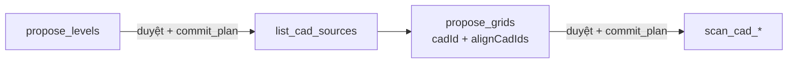
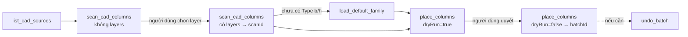

# 05 — Dựng model kết cấu từ CAD

Mục tiêu: Claude dựng cột, dầm, vách, sàn, cọc từ bản vẽ CAD đã import/link vào Revit, có người duyệt trước mỗi lần ghi. Đã có **tầng + trục, cột, dầm, vách, sàn, cọc + đài**. Mọi thứ trừ cột chưa được thử trong Revit thật.

## Lõi kết cấu

Thuật toán quét CAD và đặt phần tử nằm trong `addin/StructuralCore/`. Lõi được chép từ repo `RevitAddinManager` (`Tools/_Shared/StructuralCore/`, commit `f2db0d5`) và từ nay được duy trì riêng ở đây. Các hot tool WPF bên `RevitAddinManager` giữ bản của chúng, nên sửa lõi ở repo này không ảnh hưởng tới chúng và ngược lại.

- Các file `.cs` của lõi được **biên dịch thẳng** vào DLL add-in, không tham chiếu DLL riêng.
- Các family chuẩn (`StructuralCore/Families/*.rfa`) được nhúng vào DLL dưới tên tài nguyên `Bimtech.StructuralCore.Families.<tên file>`.

| Thành phần lõi | Vai trò |
| --- | --- |
| `Cad/CadGeometry` | Hình chữ nhật xoay nhỏ nhất, convex hull, tên layer, vùng chữ nhật |
| `Columns/ColumnScanner` | Đọc đường bao cột theo layer từ một ImportInstance |
| `Columns/ColumnPlacer` | Gom nhóm theo kích thước, xem trước và thực hiện đặt cột / tạo Type |
| `Columns/ColumnTypeMatcher` | Khớp Type theo tham số b/h |
| `Beams/` | Ghép cặp line thành dầm, sửa line mồ côi, đọc tag từ Text, nối dầm tới cột, gom nhóm, xem trước + đặt |
| `Piles/` | Quét circle/đường bao, gán cọc vào đài, gom nhóm đường kính, xem trước + đặt cọc/đài, lớp lót, bắt tròn theo lưới, join (`PileWorkflow`) |
| `Common/PlacementModels` | Kết quả đặt dùng chung, đọc tham số kích thước của Type |
| `Families/DefaultFamilies` | Nạp family chuẩn công ty (cột, dầm, cọc) từ tài nguyên nhúng |

## Tầng và trục (đi qua cửa sổ duyệt)

Khác với cột, dầm, cọc (`dryRun` rồi ghi thẳng), tầng và trục dùng khuôn propose / duyệt / commit của [04](04-architecture.md). Việc chia làm hai vòng vì trục được đọc từ CAD, mà propose không được ghi nên không thể nhập CAD trước để đọc thử.

0. (Tuỳ chọn) `suggest_levels_from_folder` với thư mục DWG: đọc **tên file** (không mở bản vẽ) để đề xuất bảng tầng, ví dụ `KC-03 MB TANG 2 (+3.600).dwg` → Tầng 2, +3600 mm. Nhận Tầng N, Hầm N, Móng, Tầng trệt, Tầng lửng, Sân thượng, Mái, Tum; cao độ theo mét (`+3.600`, `-1,500`, `±0.000`, `COS 7.20`). Số hiệu bản vẽ kiểu `KC-2.01` không bị đọc thành cao độ. Mặt cắt, chi tiết, bố trí thép được liệt kê riêng; mặt bằng điển hình không có tên tầng. Không đoán: thiếu tên hoặc cao độ thì để trống để hỏi người dùng. Có cảnh báo khi một tầng có nhiều file, thứ tự tên ngược thứ tự cao độ, hoặc chiều cao tầng bất thường.
1. `propose_levels` với danh sách `{ name, elevationMm, cadFile?, mode?, cadUnit? }`, cùng `viewTemplate?`, `scale?` cho các plan mới. Mỗi tầng là một mục `create_level`: tạo Level (hoặc dùng lại Level cùng tên, cùng cao độ), tạo Structural Plan `KC - <tên>` nếu chưa có, nhập hoặc link DWG vào plan đó tại gốc toạ độ. Không có `cadFile` thì chỉ tạo Level + plan. Tầng đã đủ và không có `cadFile` bị bỏ qua.
   - **Đối chiếu theo cao độ:** không có Level cùng tên nhưng có đúng một Level khác tên ở cùng cao độ (thường là `Level 1` của template) thì **đổi tên** Level đó thay vì tạo Level trùng cao độ; plan của nó mang tên cũ của Level (tên Revit tự đặt) cũng đổi theo thành `KC - <tên>`. Muốn giữ tên cũ thì bỏ mục đó trong cửa sổ duyệt.
   - Thành `blocked`: tên có ký tự Revit cấm (`\ : { } [ ] | ; < > ? ` ~`), thiếu file DWG, Level cùng tên nhưng khác cao độ, nhiều Level khác tên ở cùng cao độ, nhiều tầng trong danh sách cùng tên hoặc cùng cao độ, model không có loại view Structural Plan.
   - Chỉ ghi chú (vẫn duyệt được): Level đã có; Level sẽ được đổi tên; tên `KC - <tên>` đã bị view khác dùng nên plan mới thành `KC - <tên> (2)`; plan đã có CAD cùng tên file (nhập nữa sẽ thành 2 bản).
   - Tên plan hiện trong cửa sổ duyệt là đúng tên sẽ tạo.
   - **Chiều cao tầng** giữa hai tầng liên tiếp ngoài khoảng 2–8 m được ghi chú (thường là gõ nhầm, ví dụ 36000 thay vì 3600).
   - **Project Base Point** dời cao độ: mỗi mục có ghi chú "mốc cao độ chưa kiểm chứng" cho tới khi thử xong (docs/08, phần 2).
   - **Đơn vị DWG** (`cadUnit`): mặc định mm; `m`, `cm`, hoặc `auto` (theo file). Sau khi nhập, kết quả commit của mỗi mục có `cadSizeMm`; CAD rộng dưới 2 m hoặc trên 2 km có `cadWarning` (thường do sai đơn vị), khi đó Ctrl+Z rồi propose lại với `cadUnit` khác.
   - **View template và tỉ lệ** (`viewTemplate` là tên template Structural Plan, `scale` ví dụ 100): chỉ áp cho plan mới tạo. Sai tên template thì lỗi kèm danh sách template có trong model.
   - **Level thừa**: level không có phần tử nào phụ thuộc ngoài các view của chính nó, không view nào nằm trên sheet hay đang mở, và không được giữ hoặc đổi tên trong kế hoạch, được đề xuất xoá thành mục `D1`, `D2`... **mặc định Bỏ**; người dùng duyệt mục đó thì mới xoá (kèm các view của nó). Lúc commit kiểm tra lại, có gì phụ thuộc thì không xoá. Tắt bằng `proposeLevelCleanup: false`.
2. Người dùng duyệt trong Revit → `get_plan_status` → `commit_plan`. Mỗi tầng một Transaction, cả lượt một Ctrl+Z.
3. `list_cad_sources` lấy ID các CAD vừa nhập.
4. `propose_grids` với `cadId` là CAD có layer trục (tên chứa GRID, TRUC/TRỤC hoặc AXIS) và `alignCadIds` là CAD các tầng còn lại. Lõi `GridBuilder.Plan` gộp nét theo toạ độ, đặt tên trục đứng 1, 2, 3… và trục ngang A, B, C… từ dưới trái, làm tròn khoảng cách theo mm.
   - Mục `move_cad` (M1, M2…): dời từng CAD để giao điểm 1-A trùng Project Base Point. CAD đang ghim được bỏ ghim rồi ghim lại. Không có mục này khi CAD đã đúng chỗ.
   - Mục `create_grid` (G-1, G-A…): một trục mỗi mục. Trục trùng tên Grid đã có thành `blocked`.
5. Duyệt → `commit_plan`. Bỏ mục `move_cad` thì trục vẫn dựng tại Project Base Point nhưng CAD đó lệch khỏi trục.

## Vách và sàn (đi qua cửa sổ duyệt)

**Vách:** `scan_cad_walls` → `propose_walls` → duyệt → `commit_plan`.

1. `scan_cad_walls` hai lượt như dầm: lượt đầu liệt kê layer có cặp line song song (cách nhau 30–500 mm), lượt hai nhóm vách theo tên đọc từ Text + bề dày đo từ CAD (khoá `"V1|200"`, hoặc `"w200"` khi không có tên) và trả `scanId`.
2. `propose_walls` với `scanId`, `baseLevelId`, `topLevelId` (offset tuỳ chọn). Nhóm có tên được đề xuất mặc định, nhóm không tên phải nằm trong `include`. Tuỳ chọn như tool WPF: `onlySupported` bỏ vách không có vách/móng đỡ trong 500 mm bên dưới; `extendToColumns` kéo đầu vách tới cột gần nhất.
3. **Mỗi nhóm là một mục** `create_walls` (không phải mỗi bức vách), để cửa sổ duyệt không có hàng trăm dòng. Muốn bỏ một nhóm thì bỏ mục đó, hoặc gọi lại với `exclude`.
4. Type: `types` → Basic Wall cùng bề dày → Type mới `BTC-VachKC_<b>` nhân bản lúc commit từ `templateTypeId` (mặc định Type có cấu tạo lớp gần bề dày nhất). Các nhóm cùng bề dày dùng chung Type mới.
5. Lúc commit, phần tim đã có vách cùng trục bị trừ đi (kể cả vách vừa tạo ở mục trước), chỉ tạo đoạn còn thiếu ≥ 50 mm.

**Sàn:** `propose_floors` → duyệt → `commit_plan`. Sàn không đọc từ CAD mà từ **model**: tim dầm có Reference Level là tầng đó và tim vách thẳng cắt qua cao độ tầng (theo view), dò thành các ô kín; ô dưới 1 m² coi là lỗ mở. Vì vậy cần dựng dầm, vách trước.

- **Mỗi ô là một mục** `create_floor` (S1 ở góc trên trái, đọc như bản vẽ).
- Type: `floorTypeId` → `BTC_SanKC_150` → tạo `BTC_SanKC_150` (150 mm) lúc commit nếu chưa có.
- Ô có tâm nằm trong khung bao của sàn đã có được ghi chú "có thể trùng"; lúc commit, Revit kiểm tra giao nhau thật và ô chồng lên sàn cũ bị bỏ qua (ghi trong `result.skipped`), không tính là lỗi.

## Quy trình (cột)

1. `list_cad_sources`: ID các CAD trong model. CAD gắn riêng một view (`viewSpecific`) sẽ được quét trong view đó.
2. `scan_cad_columns` lần 1 (không `layers`): các layer có đường bao chữ nhật kèm số lượng. Claude hỏi người dùng layer nào là cột.
3. `scan_cad_columns` lần 2 (có `layers`): nhóm theo kích thước (khóa như `"1400x350"`, cạnh lớn trước), Type khớp đúng (`exactType`) hoặc gần nhất (`nearestType`), và `scanId`. Hình học ở lại trong add-in.
4. Nếu model chưa có Type cột nào có tham số b/h: `load_default_family` với `kind=column` nạp `BTC-CotCN_BeTong` và trả `familyId`.
5. `place_columns` với `dryRun=true` (mặc định): kế hoạch theo nhóm gồm Type dùng, Type sẽ tạo, số cột tạo, số cột trùng. Không sửa model.
6. Người dùng duyệt → `place_columns` với `dryRun=false`: tạo Type thiếu + đặt cột trong **một TransactionGroup** (một lần Ctrl+Z), trả `batchId`.
7. `undo_batch`: xóa đúng những gì batch đã tạo.

Type cho mỗi nhóm được chọn theo thứ tự: mục trong `types` → Type có sẵn khớp b/h → Type mới tạo trong `templateFamilyId` → chưa có Type. Lần chạy thật **từ chối bắt đầu** khi còn nhóm chưa có Type.

## Dầm

`scan_cad_beams` → `place_beams`, cùng khuôn với cột. Khác biệt:

- Dầm là cặp line song song; tên và kích thước đọc từ Text Note gần tim dầm (`"D2-X7(220x600)"`, khoảng tìm `textSearchMm`, mặc định 1000).
- Ba loại nhóm: theo **tên** (khóa = tên dầm, mặc định được đặt), theo **b×h** từ Text không tên (`"220x600"`), chỉ theo **bề rộng** (`"b220"`). Hai loại sau chỉ đặt khi có trong `include`; nhóm chỉ có bề rộng luôn cần Type trong `types` vì không biết h.
- `extendToColumns` + `levelId`: kéo đầu dầm tới cột gần nhất (`columnSearchMm`, mặc định 3000).
- Chống trùng tính cả dầm vừa đặt trong cùng lượt.
- Type mới tạo trong `templateFamilyId` (`load_default_family kind=beam` cho `BTC-DamCN_BeTong`); nhiều nhóm cùng b×h dùng chung 1 Type.

## Cọc và đài

`scan_cad_piles` → `place_piles`, chạy đúng chuỗi của nút "Đặt" trong tool WPF (`PileWorkflow.PlaceAll`):

1. Đặt cọc + đài. Đài là Foundation Slab trên `capLevelId`; đỉnh cọc = cao độ level − chiều dày đài; cọc ngoài mọi đài không đặt được.
2. Lớp lót dưới mỗi đài (`withLot`, mặc định có, lệch `lotOffsetMm` = 50).
3. Bắt tròn kích thước theo lưới trục trong view của CAD.
4. Join cọc với đài.

`load_default_family kind=pile` nạp `BTC-CocTron_BeTong` và tạo `BTC-DaiMong_1500` / `BTC-BeTongLot_100` khi chưa có (cần sẵn ít nhất 1 Type Foundation Slab làm mẫu). Type cọc thiếu chỉ được tạo khi `createMissingTypes=true`, nhân bản từ Type gần nhất, tên theo đường kính.

## An toàn khi ghi

| Cơ chế | Tác dụng |
| --- | --- |
| `dryRun` mặc định `true` | Muốn sửa model phải gọi rõ `dryRun=false`; mô tả công cụ yêu cầu Claude hỏi người dùng trước |
| `RequireWritableDocument()` | Từ chối family document, model chỉ đọc, hoặc khi Revit đang trong transaction khác (`-32006`) |
| `FailureGuard` | Cảnh báo Revit được ghi lại và bỏ qua; lỗi thì rollback và báo về — không có hộp thoại nào làm treo bridge |
| `TransactionGroup` | Mỗi lần ghi là một bước Undo; lỗi giữa chừng thì rollback toàn bộ |
| Chống trùng | Vị trí đã có cột cùng family, cùng khoảng cao độ, bị bỏ qua; chạy lại không tạo cột đôi |
| Giới hạn | Tối đa 5000 cột mỗi lần gọi |
| `undo_batch` | Không xóa Type/family còn được dùng (kể cả Type sàn móng); phần giữ lại vẫn gỡ được sau bằng cùng `batchId` |
| `WriteSession` | Khung chung của mọi lệnh ghi: FailureGuard + TransactionGroup + lưu batch |

`scanId` và `batchId` chỉ sống trong bộ nhớ của bridge (tối đa 20 mỗi loại) và gắn với document đã tạo ra chúng. Tắt bridge thì mất; khi đó dùng Ctrl+Z trong Revit.

## Thêm loại phần tử mới

Loại mới nên theo khuôn của tầng, trục, vách và sàn: lệnh `propose_*` chỉ đọc, phần ghi là các `IPlanAction` trong `addin/Planning/Actions/` (đăng ký ở `PlanActions.CreateDefault`), mỗi mục có `params.summary` để cửa sổ duyệt hiện một câu dễ đọc.

1. Nếu lõi chưa có loại đó: viết scanner/placer trong `addin/StructuralCore/<Loại>/`, không phụ thuộc UI (có thể tham khảo tool WPF bên `RevitAddinManager` nhưng không sửa repo đó). Thêm hàm `Plan*` xem trước cho mỗi thao tác ghi.
2. Thêm `Scan<Loại>Command` và `Place<Loại>Command` trong `addin/Commands/Structural/` theo mẫu cột/dầm: kết quả quét lưu bằng `context.Sessions.Add`, lần chạy thật bọc trong `WriteSession`.
3. Khai báo công cụ trong `server/src/tools/structural.ts`; `tests/contract.test.mjs` kiểm tra hai phía khớp tên.
