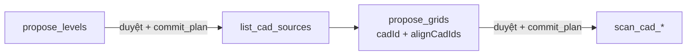
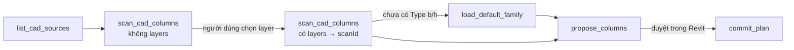

# 05 — Dựng model kết cấu từ CAD

Mục tiêu: Claude dựng cột, dầm, vách, sàn, cọc từ bản vẽ CAD đã import/link vào Revit, có người duyệt trước mỗi lần ghi. Đã có **tầng + trục, cột, dầm, vách, sàn, cọc + đài**. Mọi thứ trừ cột chưa được thử trong Revit thật.

## Lõi kết cấu

Thuật toán quét CAD và đặt phần tử nằm trong `addin/StructuralCore/`. Lõi được chép từ repo `RevitAddinManager` (`Tools/_Shared/StructuralCore/`, commit `f2db0d5`) và từ nay được duy trì riêng ở đây. Các hot tool WPF bên `RevitAddinManager` giữ bản của chúng, nên sửa lõi ở repo này không ảnh hưởng tới chúng và ngược lại.

- Các file `.cs` của lõi được **biên dịch thẳng** vào DLL add-in, không tham chiếu DLL riêng.
- Các family chuẩn (`StructuralCore/Families/*.rfa`) được nhúng vào DLL dưới tên tài nguyên `Bimtech.StructuralCore.Families.<tên file>`.

| Thành phần lõi | Vai trò |
| --- | --- |
| `Cad/CadGeometry` | Hình chữ nhật xoay nhỏ nhất, convex hull, tên layer, vùng chữ nhật |
| `Columns/ColumnScanner` | Đọc đường bao cột theo layer từ một ImportInstance |
| `Columns/ColumnPlacer` | Gom nhóm theo kích thước, xem trước và thực hiện đặt cột / tạo Type |
| `Columns/ColumnTypeMatcher` | Khớp Type theo tham số b/h |
| `Beams/` | Ghép cặp line thành dầm, sửa line mồ côi, đọc tag từ Text, nối dầm tới cột, gom nhóm, xem trước + đặt |
| `Piles/` | Quét circle/đường bao, gán cọc vào đài, gom nhóm đường kính, xem trước + đặt cọc/đài, lớp lót, bắt tròn theo lưới, join (`PileWorkflow`) |
| `Common/PlacementModels` | Kết quả đặt dùng chung, đọc tham số kích thước của Type |
| `Families/DefaultFamilies` | Nạp family chuẩn công ty (cột, dầm, cọc) từ tài nguyên nhúng |

## Tầng và trục (đi qua cửa sổ duyệt)

Tầng và trục dùng khuôn propose / duyệt / commit của [04](04-architecture.md) như mọi loại khác. Việc chia làm hai vòng vì trục được đọc từ CAD, mà propose không được ghi nên không thể nhập CAD trước để đọc thử.

0. (Tuỳ chọn) `suggest_levels_from_folder` với thư mục DWG: đọc **tên file** (không mở bản vẽ) để đề xuất bảng tầng, ví dụ `KC-03 MB TANG 2 (+3.600).dwg` → Tầng 2, +3600 mm. Nhận Tầng N, Hầm N, Móng, Tầng trệt, Tầng lửng, Sân thượng, Mái, Tum; cao độ theo mét (`+3.600`, `-1,500`, `±0.000`, `COS 7.20`). Số hiệu bản vẽ kiểu `KC-2.01` không bị đọc thành cao độ. Mặt cắt, chi tiết, bố trí thép được liệt kê riêng; mặt bằng điển hình không có tên tầng. Không đoán: thiếu tên hoặc cao độ thì để trống để hỏi người dùng. Có cảnh báo khi một tầng có nhiều file, thứ tự tên ngược thứ tự cao độ, hoặc chiều cao tầng bất thường.
1. `propose_levels` với danh sách `{ name, elevationMm, cadFile?, mode?, cadUnit? }`, cùng `viewTemplate?`, `scale?` cho các plan mới. Mỗi tầng là một mục `create_level`: tạo Level (hoặc dùng lại Level cùng tên, cùng cao độ), tạo Structural Plan `KC - <tên>` nếu chưa có, nhập hoặc link DWG vào plan đó tại gốc toạ độ. Không có `cadFile` thì chỉ tạo Level + plan. Tầng đã đủ và không có `cadFile` bị bỏ qua.
   - **Đối chiếu theo cao độ:** không có Level cùng tên nhưng có đúng một Level khác tên ở cùng cao độ (thường là `Level 1` của template) thì **đổi tên** Level đó thay vì tạo Level trùng cao độ; plan của nó mang tên cũ của Level (tên Revit tự đặt) cũng đổi theo thành `KC - <tên>`. Muốn giữ tên cũ thì bỏ mục đó trong cửa sổ duyệt.
   - Thành `blocked`: tên có ký tự Revit cấm (`\ : { } [ ] | ; < > ? ` ~`), thiếu file DWG, Level cùng tên nhưng khác cao độ, nhiều Level khác tên ở cùng cao độ, nhiều tầng trong danh sách cùng tên hoặc cùng cao độ, model không có loại view Structural Plan.
   - Chỉ ghi chú (vẫn duyệt được): Level đã có; Level sẽ được đổi tên; tên `KC - <tên>` đã bị view khác dùng nên plan mới thành `KC - <tên> (2)`; plan đã có CAD cùng tên file (nhập nữa sẽ thành 2 bản).
   - Tên plan hiện trong cửa sổ duyệt là đúng tên sẽ tạo.
   - **Chiều cao tầng** giữa hai tầng liên tiếp ngoài khoảng 2–8 m được ghi chú (thường là gõ nhầm, ví dụ 36000 thay vì 3600).
   - **Project Base Point** dời cao độ: mỗi mục có ghi chú "mốc cao độ chưa kiểm chứng" cho tới khi thử xong (docs/08, phần 2).
   - **Đơn vị DWG** (`cadUnit`): mặc định mm; `m`, `cm`, hoặc `auto` (theo file). Sau khi nhập, kết quả commit của mỗi mục có `cadSizeMm`; CAD rộng dưới 2 m hoặc trên 2 km có `cadWarning` (thường do sai đơn vị), khi đó Ctrl+Z rồi propose lại với `cadUnit` khác.
   - **View template và tỉ lệ** (`viewTemplate` là tên template Structural Plan, `scale` ví dụ 100): chỉ áp cho plan mới tạo. Sai tên template thì lỗi kèm danh sách template có trong model.
   - **Level thừa**: level không có phần tử nào phụ thuộc ngoài các view của chính nó, không view nào nằm trên sheet hay đang mở, và không được giữ hoặc đổi tên trong kế hoạch, được đề xuất xoá thành mục `D1`, `D2`... **mặc định Bỏ**; người dùng duyệt mục đó thì mới xoá (kèm các view của nó). Lúc commit kiểm tra lại, có gì phụ thuộc thì không xoá. Tắt bằng `proposeLevelCleanup: false`.
2. Người dùng duyệt trong Revit → `get_plan_status` → `commit_plan`. Mỗi tầng một Transaction, cả lượt một Ctrl+Z.
3. `list_cad_sources` lấy ID các CAD vừa nhập.
4. `propose_grids` với `cadId` là CAD có trục và `alignCadIds` là CAD các tầng còn lại.
   - **Tìm trục** (`addin/Recognition/GridRecognizer.cs`): line dài đứng/ngang (phủ ít nhất 30% bản vẽ) theo từng graphics style, chấm điểm theo **line pattern** (nét tâm, chấm gạch) trước, rồi **vòng tròn đầu trục**, cuối cùng **tên layer** (GRID, TRUC/TRỤC, AXIS). Chọn sai thì truyền `gridLayer`. Không tìm được trục ở cả hai phương thì báo lỗi kèm điểm của từng style.
   - **Tên trục** lấy từ text trong vòng tròn đầu trục khi đọc được (Text Note), giữ được `1'`, `C1`; không thì trục đứng 1, 2, 3… trái sang phải, trục ngang A, B, C… dưới lên. Hai trục cùng tên thì trục sau bị chặn.
   - **Sửa nhịp lệch** (`GridLayout.Snap`): mỗi nhịp giữa hai trục liền nhau được làm tròn về bội của `snapModuleMm` (mặc định 50) khi lệch không quá `snapToleranceMm` (mặc định 10): 5998,7 → 6000. Vị trí trục là tổng các nhịp đã làm tròn tính từ trục đầu, nên sai số không cộng dồn. Nhịp lệch quá ngưỡng giữ số đo (làm tròn 1 mm) và có ghi chú. `snapModuleMm: 0` chỉ làm tròn 1 mm.
   - **Trục đầu tiên** mỗi phương (trái nhất, dưới nhất) nằm trên Project Base Point.
   - **Căn từng CAD theo trục của chính nó** (`GridLayout.Match`): tìm trục trong từng CAD của `alignCadIds` và đối chiếu khoảng cách trục với CAD gốc (sai số 20 mm, cho phép bản vẽ tầng chỉ có một phần các trục). Khớp duy nhất thì CAD đó dời theo vector riêng; không tìm được trục hoặc khớp nhiều chỗ (lưới đều) thì dời theo vector của CAD gốc và mục `move_cad` ghi rõ để người duyệt kiểm tra.
   - **Trục xiên** chưa dựng: được đếm và cảnh báo, không bỏ qua lặng lẽ.
   - Mục `move_cad` (M1, M2…) và `create_grid` (G-1, G-A…), mô tả như `Trục B (ngang): y = 6000 mm từ gốc, nhịp 6000`. Trục và CAD được **ghim** sau khi ghi (`pin: false` để không ghim). Trục trùng tên Grid đã có thì bị chặn.
5. Duyệt → `commit_plan`. Bỏ mục `move_cad` thì trục vẫn dựng tại Project Base Point nhưng CAD đó lệch khỏi trục.

Sau khi nhập CAD (`propose_levels`), kết quả commit có `cadWarning` khi CAD nằm cách gốc toạ độ trên 10 km (bản vẽ dùng toạ độ thực tế như VN-2000). `propose_grids` sẽ dời nó về trục.

`GridBuilder` (lõi cũ, chỉ theo tên layer) vẫn dùng cho tool WPF qua `LevelSetup.ApplyRow`, không còn dùng trong MCP.

## Vách và sàn (đi qua cửa sổ duyệt)

**Vách:** `scan_cad_walls` → `propose_walls` → duyệt → `commit_plan`.

1. `scan_cad_walls` đọc vách **từ hatch của chính file DWG** (đọc từ ổ đĩa vì Revit không cho đọc hatch; CAD link tự lấy đường dẫn, CAD import truyền `dwgPath`). File được đặt lên CAD bằng cách khớp line, không tin cách Revit đặt. Mỗi vùng hatch được cắt thành các nhánh (lõi chữ L, T, U ra mỗi nhánh một vách), dải cùng bề dày trên một đường được gộp, đầu vách chạm mặt vách vuông góc được kéo về tim (như Revit nối vách). Hatch có cạnh dài ≤ 1 m là **cột**, không bao giờ là vách.
   Mỗi vách được **chấm điểm như kỹ sư**, mỗi điểm kèm lý do: +1 có hatch; +2 cùng kiểu hatch với cột đã dựng (+1 nếu chỉ đoán theo hình vuông); +1 dày đúng cỡ vách bê tông (150–500, bội 50); +1 nằm trên trục; +1 nối vào cột; +2 trùng vách tầng dưới; +1 thuộc cụm vách (lõi); +1 có chữ thang máy trong lõi; ±1 tên layer giống vách / giống cột, tường xây; −2 dày cỡ tường xây (100/110/220…); −1 ngắn so với bề dày (cột dẹt); −3 layer đang tắt. Từ 3 điểm: nhóm `"w300"` (đề xuất mặc định); 1–2 điểm: nhóm `"w300-maybe"` (phải `include`); ≤ 0: loại, vẫn báo lý do. Vùng đọc mặc định là phạm vi trục trong model + 3 m (một file DWG thường có nhiều mặt bằng), nên **dựng trục và cột trước**.
   Bản vẽ không có hatch: truyền `layers` để dùng cách cũ (ghép cặp line song song, tên từ Text Note).
2. `propose_walls` với `scanId`, `baseLevelId`, `topLevelId` (offset tuỳ chọn). Nhóm `wNNN` (hoặc có tên, cách cũ) được đề xuất mặc định, nhóm còn lại phải nằm trong `include`. Mỗi mục trong cửa sổ duyệt có dòng **"Vì sao"** đếm bằng chứng của nhóm (vd `+1 nằm trên trục (12/14)`) và các trục vách nằm trên. Tuỳ chọn như tool WPF: `onlySupported` bỏ vách không có vách/móng đỡ trong 500 mm bên dưới; `extendToColumns` kéo đầu vách tới cột gần nhất.
3. **Mỗi nhóm là một mục** `create_walls` (không phải mỗi bức vách), để cửa sổ duyệt không có hàng trăm dòng. Muốn bỏ một nhóm thì bỏ mục đó, hoặc gọi lại với `exclude`.
4. Type: `types` → Basic Wall cùng bề dày → Type mới `BTC-VachKC_<b>` nhân bản lúc commit từ `templateTypeId` (mặc định Type có cấu tạo lớp gần bề dày nhất). Các nhóm cùng bề dày dùng chung Type mới.
5. Lúc commit, phần tim đã có vách cùng trục bị trừ đi (kể cả vách vừa tạo ở mục trước), chỉ tạo đoạn còn thiếu ≥ 50 mm.

**Sàn:** `propose_floors` → duyệt → `commit_plan`. Sàn không đọc từ CAD mà từ **model**: tim dầm có Reference Level là tầng đó và tim vách thẳng cắt qua cao độ tầng (theo view), dò thành các ô kín; ô dưới 1 m² coi là lỗ mở. Vì vậy cần dựng dầm, vách trước.

- **Mỗi ô là một mục** `create_floor` (S1 ở góc trên trái, đọc như bản vẽ).
- Type: `floorTypeId` → `BTC_SanKC_150` → tạo `BTC_SanKC_150` (150 mm) lúc commit nếu chưa có.
- Ô có tâm nằm trong khung bao của sàn đã có được ghi chú "có thể trùng"; lúc commit, Revit kiểm tra giao nhau thật và ô chồng lên sàn cũ bị bỏ qua (ghi trong `result.skipped`), không tính là lỗi.

## Quy trình (cột)

1. `list_cad_sources`: ID các CAD trong model. CAD gắn riêng một view (`viewSpecific`) sẽ được quét trong view đó.
2. `scan_cad_columns` lần 1 (không `layers`): các layer có đường bao chữ nhật kèm số lượng và số hình bị loại. Claude hỏi người dùng layer nào là cột.
3. `scan_cad_columns` lần 2 (có `layers`):
   - **Chỉ nhận hình chữ nhật thật** (PolyLine hoặc line rời), cạnh 100–2000 mm: mọi đầu mút nằm trên biên và bốn cạnh được vẽ đủ ít nhất 90%. Hatch bên trong không ảnh hưởng. Mũi tên, nét ghi chú, **cột chữ L**, **cột vẽ dính vách cùng layer** không thành cột mà nằm trong `notRectangles` để người dùng xem (không đặt).
   - Line rời được gom bằng lưới không gian, nên layer hàng chục nghìn line (hatch) vẫn quét nhanh.
   - **Ký hiệu cột** đọc từ Text Note gần nhất trong 1500 mm (`C1 300x500`); mỗi text chỉ gán cho cột gần nó nhất.
   - Nhóm theo ký hiệu và kích thước: khóa `"C1"`, hoặc `"C1 300x500"` khi một ký hiệu có nhiều kích thước, hoặc kích thước **b×h cạnh nhỏ trước** `"300x500"` khi không có ký hiệu (trùng tên Type tạo mới). Ký hiệu ghi kích thước khác hình vẽ thì có `tagSizeMismatch`.
   - Type khớp đúng (`exactType`) hoặc gần nhất (`nearestType`), và `scanId`. Hình học ở lại trong add-in.
4. Nếu model chưa có Type cột nào có tham số b/h: `load_default_family` với `kind=column` nạp `BTC-CotCN_BeTong` và trả `familyId`.
5. `propose_columns` với base/top level: **mỗi nhóm là một mục duyệt**.
   - **Cột thường đứng ở giao hai trục.** Xét từng phương: trục đi qua cột hoặc cách mặt cột không quá `gridMarginMm` (mặc định 300) là cột nằm trên trục đó. Khi đó độ lệch cách **đồng tâm** hoặc **mép trùng trục** không quá `gridToleranceMm` (mặc định 15) được đặt đúng vào đó; độ lệch khác **làm tròn 5 mm** (`snapMm`). Cột không nằm trên trục nào chỉ được làm tròn 5 mm.
   - Mục duyệt ghi các giao trục của nhóm (`tại A-1, A-2…`); cột chỉ nằm trên một trục (cột phụ, cột thang?) hoặc không nằm trên trục nào có ghi chú. Kết quả trả `emptyCrossings`: **giao trục không có cột** trong vùng các cột (ô thông tầng, hay cột vẽ ở layer khác) để người dùng kiểm tra.
   - Cột vẽ lệch dưới 2° so với phương trục được **đặt thẳng theo trục** (chọn hướng trục gần nhất, không đổi chỗ b/h).
   - Cột vẽ trùng (cùng tâm) chỉ đặt một lần; cột đã có trong model ở đó (**mọi family**, cao độ chồng nhau) bị bỏ qua.
   - Ký hiệu được ghi vào tham số **Mark** (`writeMark`, mặc định có).
6. Duyệt → `commit_plan`: mỗi nhóm một Transaction, cả lượt một Ctrl+Z.

Type cho mỗi nhóm: mục trong `types` → Type có sẵn khớp b/h → Type `b×h` tạo trong `templateFamilyId` → chưa có Type (mục bị chặn). Cột tròn chưa hỗ trợ.

## Dầm

`propose_beams` → duyệt → `commit_plan`. Hiện chỉ **dầm chính** (nối cột với cột hoặc vách); dầm phụ, dầm console làm sau.

**Lan từ cột, trục làm thước.** Dựng cột (và vách) bên dưới tầng trước: chúng là gối tựa. Không cần bước quét riêng, không cần chọn layer (`layers` chỉ để giới hạn khi cần).

1. Gối tựa: cột và vách **trong model** có chiều cao chạm cao độ tầng (cột tầng dưới và tầng trên cùng chỗ chỉ tính một). Đường bao lấy từ hình khối thật của family.
2. Line CAD: chỉ giữ line theo phương trục (lệch ≤ 2°; line xiên được đếm); line nằm trọn trong cột hoặc vách (đường bao, hatch) bị bỏ.
3. Ở mỗi mặt cột: cặp line song song **xuất phát trong 300 mm** (`probeMm`) từ mặt cột, cách nhau 100–1000 mm (`minWidthMm`/`maxWidthMm`), tim nằm trong bề rộng cột, là đầu một dầm. Line nằm đúng giữa hai line khác là **nét tim**, không phải mép dầm.
4. Dò dọc hai mép, nhảy qua chỗ đứt tới 1500 mm (`maxGapMm`, chỗ dầm khác cắt ngang), tới **cột hoặc vách đầu tiên** cùng dải. Hai mép phải vẽ đủ ít nhất 60% nhịp (`minCoverage`).
5. Dầm đặt **từ tim cột tới tim cột** (vách: tới tim vách). **Chỉ chia tại gối tựa**, giao trục không có cột thì dầm chạy liền qua.
6. Mép dầm đi ra từ cột mà không tới gối tựa nào → **đầu dầm lơ lửng** (`report.dangling`): dầm phụ hoặc console, chưa dựng.

**Ký hiệu dầm** (`D1 (220x600)`, `220X600`, `DC1 250*500`, `DP3`) đọc từ Text Note trong view, kể cả mã định dạng MText:
- Mỗi ký hiệu gán cho dầm **cùng phương với chữ** gần nhất trong 1000 mm (`tagDistanceMm`), rồi **lan sang các dầm thẳng hàng** (cùng bề rộng, chung gối tựa) tới khi gặp ký hiệu khác.
- b lấy theo ký hiệu, không có thì đo từ nét (làm tròn 5 mm); ký hiệu ghi b khác nét đo quá 10 mm thì có ghi chú. **h chỉ lấy từ ký hiệu** hoặc `heightsMm`; không có thì mục **bị chặn** để hỏi người dùng, không đoán.
- Ký hiệu không gán được dầm nào nằm trong `report.unusedMarks`.

**Trục**: độ lệch tim dầm so với trục đặt như cột (đồng tâm hoặc mép trùng trục trong `gridToleranceMm` thì đặt đúng, còn lại làm tròn `snapMm`). Mỗi dầm ghi `A-1 → A-2 (trục A)`; dầm không nằm trên trục nào có ghi chú.

**Mục duyệt**: mỗi nhóm (ký hiệu + kích thước; khóa `"D1"`, `"D1 220x600"` khi một ký hiệu có nhiều kích thước, `"220x600"`, hoặc `"b220"` khi chưa biết h) là một mục, ghi các nhịp, số dầm lấy ký hiệu từ dầm bên cạnh, dầm nét đứt nhiều (phủ dưới 90%). Dầm đã có trong model trên cùng trục bị bỏ qua. Cao độ đỉnh dầm = tầng + `offsetMm`. Ký hiệu ghi vào **Mark** (`writeMark`).

Type mỗi nhóm: mục trong `types` → Type có sẵn khớp b×h → Type `b×h` tạo trong `templateFamilyId` (mặc định `BTC-DamCN_BeTong` nếu đã nạp; `load_default_family kind=beam`) → chưa có Type (mục bị chặn).

**Giới hạn đã biết**: Revit API không đọc được chữ bên trong file DWG import/link, chỉ đọc Text Note của Revit. Nếu bản vẽ chưa có Text Note, dầm vẫn được nhận nhưng không có ký hiệu (cần `heightsMm` hoặc `types`).

## Cọc và đài

`scan_cad_piles` → `propose_piles` → duyệt → `commit_plan`. Chỉ hỗ trợ **cọc tròn**; cọc vuông chưa hỗ trợ.

**Quét** (`scan_cad_piles`, hai lượt như cột):
- Cọc là hình tròn trên layer cọc; hai vòng đồng tâm (vẽ lồng) gộp thành một. Nhóm theo đường kính (`D600`).
- Đài là PolyLine khép kín trên layer đài, **hoặc line rời** (bản vẽ đã explode) được ghép thành vòng kín. Hai đường bao vẽ trùng (ván khuôn và bê tông) gộp thành một.
- **Cọc thuộc đài** chứa nó; cọc ngoài biên trong 300 mm vẫn thuộc đài gần nhất (vẽ lệch nhẹ); **xa hơn thì không thuộc đài nào** và được báo ra, không bị gán bừa cho một đài ở xa.
- **Ký hiệu đài** đọc từ Text Note trong hoặc cạnh đài: `Đ1 (2000x2000x1200)`, `ĐM2 h=1500`, `ĐC3 - 1500X2400 - H=1000`. Đài gom thành nhóm (`capGroups`) theo ký hiệu, không có ký hiệu thì theo kích thước (`2000x2000`), kèm chiều dày đọc được.

**Đề xuất** (`propose_piles`): **mỗi đài là một mục** gồm đài, các cọc của nó và lớp lót.
- **Chiều dày đài theo từng nhóm**, theo thứ tự: `capTypes` → `capThicknessMm` → chiều dày ghi trong ký hiệu bản vẽ → `capFloorTypeId` (chung) → **chặn**, để Claude hỏi người dùng, không đoán. Có chiều dày mà chưa có Type thì lúc commit tạo `BTC-DaiMong_<h>` từ `capTemplateTypeId` (mặc định `BTC-DaiMong_1500`). Đỉnh cọc = cao độ level − chiều dày **của đài chứa nó**.
- **Làm tròn 5 mm** (`snapMm`): cạnh đài được làm vuông theo phương hệ trục rồi làm tròn bội 5 mm (1498,7 → 1500); đài và cọc được dời để khoảng cách tới trục gần nhất là bội 5 mm. Tính trước khi dựng nên đài (là Floor) cũng được làm tròn, không chỉ cọc.
- Lớp lót dưới mỗi đài (`withLot`, mặc định có, rộng thêm `lotOffsetMm` = 50).
- **Join chỉ giữa cọc với đài và lớp lót của chính nó**, không đụng join có sẵn trong model.
- `pileLengthMm`: đặt chiều dài cọc vào tham số `Length` (hoặc `Pile Length`, `Chiều dài`, `L`) nếu family có; không có thì kết quả có cảnh báo.
- Đài đã có ở vị trí đó thì bỏ qua (`alreadyModeledCaps`); cọc đã có thì bỏ qua từng cọc.
- Cọc không thuộc đài nào gom thành một mục `P-NOCAP` bị chặn, liệt kê vị trí để kiểm tra.

`load_default_family kind=pile` nạp `BTC-CocTron_BeTong` và tạo `BTC-DaiMong_1500` / `BTC-BeTongLot_100` khi chưa có (cần sẵn ít nhất 1 Type Foundation Slab làm mẫu). Type cọc thiếu chỉ được tạo khi `createMissingTypes=true`, nhân bản từ Type gần nhất, tên theo đường kính. Gốc chèn của family cọc (đỉnh hay mũi cọc) cần kiểm chứng trong Revit.

## An toàn khi ghi

| Cơ chế | Tác dụng |
| --- | --- |
| `propose_*` chỉ đọc | Mọi thay đổi đi qua cửa sổ duyệt; chỉ `commit_plan` ghi, và chỉ những mục người dùng đã duyệt |
| `RequireWritableDocument()` | Từ chối family document, model chỉ đọc, hoặc khi Revit đang trong transaction khác (`-32006`) |
| `FailureGuard` | Cảnh báo Revit được ghi lại và bỏ qua; lỗi thì rollback và báo về — không có hộp thoại nào làm treo bridge |
| `TransactionGroup` | Mỗi lần ghi là một bước Undo; lỗi giữa chừng thì rollback toàn bộ |
| Chống trùng | Vị trí đã có cột cùng family, cùng khoảng cao độ, bị bỏ qua; chạy lại không tạo cột đôi |
| Giới hạn | Tối đa 5000 cột mỗi lần gọi |
| `undo_batch` | Không xóa Type/family còn được dùng (kể cả Type sàn móng); phần giữ lại vẫn gỡ được sau bằng cùng `batchId` |
| `WriteSession` | Khung chung của mọi lệnh ghi: FailureGuard + TransactionGroup + lưu batch |

`scanId` và `batchId` chỉ sống trong bộ nhớ của bridge (tối đa 20 mỗi loại) và gắn với document đã tạo ra chúng. Tắt bridge thì mất; khi đó dùng Ctrl+Z trong Revit.

## Thêm loại phần tử mới

Loại mới nên theo khuôn của tầng, trục, vách và sàn: lệnh `propose_*` chỉ đọc, phần ghi là các `IPlanAction` trong `addin/Planning/Actions/` (đăng ký ở `PlanActions.CreateDefault`), mỗi mục có `params.summary` để cửa sổ duyệt hiện một câu dễ đọc.

1. Nếu lõi chưa có loại đó: viết scanner/placer trong `addin/StructuralCore/<Loại>/`, không phụ thuộc UI (có thể tham khảo tool WPF bên `RevitAddinManager` nhưng không sửa repo đó). Thêm hàm `Plan*` xem trước cho mỗi thao tác ghi.
2. Thêm `Scan<Loại>Command` và `Place<Loại>Command` trong `addin/Commands/Structural/` theo mẫu cột/dầm: kết quả quét lưu bằng `context.Sessions.Add`, lần chạy thật bọc trong `WriteSession`.
3. Khai báo công cụ trong `server/src/tools/structural.ts`; `tests/contract.test.mjs` kiểm tra hai phía khớp tên.
