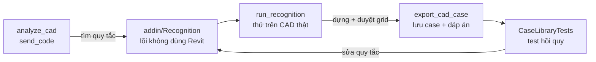
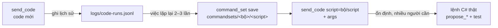

# 07 — Bộ công cụ cho người phát triển

Bộ công cụ này chỉ dành cho người phát triển. Người dùng khác **không nhận** DLL của nó và server **không khai báo** các tool này, nên họ không thấy và không gọi được.

Mục đích: mỗi bản vẽ thật được thử là một lần làm cho bộ nhận diện tốt hơn, và tốt hơn **đo được**. Khám phá bằng code tuỳ ý (đắt nhưng linh hoạt) → tìm ra quy tắc hiệu quả → đóng gói thành lõi nhận diện có test (rẻ, ổn định) → lưu bản vẽ thành case để không bao giờ làm hỏng lại.



## Các tool

| Tool | Làm gì |
| --- | --- |
| `send_code` | Biên dịch (Roslyn) và chạy C# trên model đang mở: một đoạn code mới (`code`) hoặc một script trong command set (`script` + `args`). `write=false` (mặc định): chạy trong `TransactionGroup` **luôn bị rollback**, model không bao giờ bị đổi. `write=true`: chạy thử rồi huỷ, sau đó mở **cửa sổ duyệt** với mục đích, kết quả chạy thử và toàn bộ code; chỉ `commit_plan` sau khi duyệt mới chạy thật (xem mục Send code). `FailureGuard` chặn hộp thoại; có chốt chặn treo và sập (xem bên dưới). Không chặn đọc/ghi file. |
| `command_set` | `list`: các bộ script trong `commandsets/`. `save`: lưu một đoạn code đã chạy tốt thành script có tên và tham số (phải biên dịch được). `history`: các lần `send_code` gần nhất, để nhận ra việc lặp lại. |
| `analyze_cad` | Dấu vân tay của một CAD: mỗi layer có gì (line pattern, màu, số line, tỉ lệ line đứng/ngang, đường kính tròn, kích thước chữ nhật, bề rộng cặp line song song), text hay gặp, ứng viên trục tốt nhất. Đủ gọn để Claude đọc cả bản vẽ trong một lần. |
| `run_recognition` | Chạy lõi nhận diện trục trên CAD thật; nếu model đã có grid thì coi đó là đáp án và so sánh (khớp, sai tên, thiếu, thừa). |
| `export_cad_case` | Lưu CAD thành `cases/<caseId>/case.json` (dữ liệu thuần: line, arc, tròn, polyline kèm layer/pattern/màu, text của view). Mặc định lưu kèm grid trong model làm **đáp án**: xuất sau khi đã dựng và duyệt grid của bản vẽ. Với tầng của view (hoặc `levelId`), lưu thêm **cột và vách** chạm tầng đó (gối tựa dầm) và **dầm** của tầng làm đáp án dầm: xuất mặt bằng dầm sau khi đã dựng, kiểm tra và sửa dầm. Đọc thêm **chính file DWG** trên ổ đĩa (ACadSharp) để lấy **hatch** (kèm đường biên) và **chữ** mà Revit không cho đọc: CAD link thì tự lấy đường dẫn, CAD import thì truyền `dwgPath`. Vị trí file trong model được tìm bằng cách khớp line của file với line Revit báo (không tin cách Revit đặt); chỉ thêm khi khớp ≥ 70%. Kết quả có phần `dwg`: vị trí, tỉ lệ khớp, hatch theo layer/mẫu. File lớn mất khoảng 1 phút. |

Đoạn code của `send_code` là thân của `static object Run(QueryContext ctx)`: có sẵn `doc`, `uidoc`, `view`, `ctx`; đã `using` System.Linq, Autodesk.Revit.DB và DB.Structure. Trả về object ẩn danh hoặc danh sách số/chuỗi, không trả phần tử Revit. `ctx.Print(x)` ghi log; `ctx.Mm(feet)`, `ctx.Feet(mm)` đổi đơn vị; tham số đọc bằng `ctx.Str("x")`, `ctx.Num`, `ctx.Bool`, `ctx.Id`, `ctx.Strs`, `ctx.Ids`, `ctx.Has`.

```csharp
var cad = new FilteredElementCollector(doc).OfClass(typeof(ImportInstance)).First();
var styles = new Dictionary<string, int>();
foreach (var item in cad.get_Geometry(new Options { View = view }))
    if (item is GeometryInstance gi)
        foreach (var g in gi.GetInstanceGeometry())
        {
            var name = (doc.GetElement(g.GraphicsStyleId) as GraphicsStyle)?.GraphicsStyleCategory?.Name ?? "?";
            styles[name] = styles.GetValueOrDefault(name) + 1;
        }
return styles.OrderByDescending(s => s.Value);
```

## Send code và command set

Nơi giải quyết **trường hợp đặc biệt** mà chưa tool nào làm được, và nơi **đóng gói** những việc lặp lại.



**Ghi vào model (`write=true`)**, theo khuôn propose → duyệt → commit như các tool kết cấu:

1. Code chạy thử trong **một Transaction đang mở sẵn** (nên code không tự mở Transaction; SubTransaction thì được), Revit kiểm tra thay đổi, rồi toàn bộ bị **huỷ**. Kết quả: số phần tử tạo / sửa / xoá theo category, giá trị trả về, log.
2. Lỗi biên dịch, lỗi chạy, Revit từ chối thay đổi → trả lỗi, **không tạo kế hoạch**.
3. Chạy thử thành công → kế hoạch một mục `run_code` mở trong cửa sổ duyệt. Chọn dòng đó để xem **mục đích, kết quả chạy thử và toàn bộ code** ở khung dưới.
4. Duyệt → `commit_plan` chạy **đúng đoạn code đã duyệt** (kiểm bằng SHA-256; file kế hoạch bị sửa thì từ chối), trong một bước Ctrl+Z. Model đổi sau lúc chạy thử thì `commit_plan` từ chối, chạy thử lại.

**Command set** nằm ở `commandsets/` tại gốc repo (**được commit**, có lịch sử git). Mỗi bộ là một thư mục:

```
commandsets/family-tcvn/
  set.json               { "description": "Chuẩn hoá family theo TCVN" }
  rename-params.cs       code, đọc tham số bằng ctx.Str("prefix")...
  rename-params.json     { "description", "write": true,
                           "params": [{ "name": "prefix", "type": "string", "default": "BTC_" },
                                      { "name": "ids", "type": "elementId[]", "required": true }],
                           "notes": ["Dùng cho family cột 2026-10"] }
```

- Kiểu tham số: `string`, `number`, `boolean`, `elementId`, `string[]`, `elementId[]`. Tham số được kiểm tra trước khi chạy (thiếu, sai kiểu, tên lạ → lỗi), mặc định được điền sẵn.
- Script có `write: true` luôn đi qua cửa sổ duyệt; script chỉ đọc (ví dụ kiểm tra model) chạy ngay.
- Claude xem `command_set list` trước khi viết code mới; khi thấy cùng loại việc trong `command_set history` 2–3 lần, Claude **đề xuất** đóng gói (tên, tham số, mô tả) và chỉ lưu khi bạn đồng ý. Sau đó commit file bằng git như code thường.
- Lịch sử `logs/code-runs.jsonl` (gitignore; có thể chứa tên model): mỗi lần chạy thử, đọc, commit một dòng. Đổi chỗ bằng `BIMTECH_CODE_HISTORY`; thư mục command set bằng `BIMTECH_COMMANDSETS_DIR`.

### Chốt chặn treo và sập Revit

Đoạn code chạy trên luồng chính của Revit, và .NET không thể ngắt một luồng đang chạy. Nếu không có biện pháp gì, một vòng lặp vô hạn sẽ **treo Revit đến khi tắt hẳn**, còn đệ quy vô hạn gây **tràn stack**, lỗi mà .NET không bắt được, và **Revit sập** mất dữ liệu chưa lưu.

Vì vậy trước khi biên dịch, `devtools/QueryGuardInserter.cs` viết lại đoạn code để nó tự dừng được (`devtools/QueryGuard.cs`):

| Chèn vào | Tác dụng | Kết quả trả về |
| --- | --- | --- |
| `QueryGuard.Tick()` ở đầu **mọi vòng lặp** (`for`, `foreach`, `while`, `do`) | Quá `timeoutSeconds` (mặc định 30, tối đa 110) hoặc Claude ngừng chờ thì dừng | `stage: "timeout"` hoặc `"cancelled"` |
| `Enter()` / `try … finally Exit()` quanh **mọi hàm cục bộ, lambda, anonymous method** | Đếm độ sâu gọi hàm; quá 1000 tầng thì dừng trước khi tràn stack | `stage: "recursion"` |

Dù dừng kiểu nào, transaction vẫn rollback và Revit lấy lại quyền điều khiển. Lỗi biên dịch được đọc từ code gốc nên số dòng vẫn đúng. Lambda chuyển thành expression tree (`Expression<Func<…>>`) được giữ nguyên. `tests/Bimtech.RevitMcp.DevTools.Tests` chạy thật các vòng lặp và đệ quy vô hạn (9 kiểu vòng lặp, 5 kiểu đệ quy) để chứng minh chúng dừng đúng, và kiểm tra code bình thường vẫn cho cùng kết quả.

Những gì chốt chặn **không** dừng được:
- Một lệnh Revit API chạy lâu (ví dụ regenerate model lớn): không vô hạn, nhưng phải chờ nó xong.
- Vòng lặp nằm **bên trong thư viện** chứ không trong đoạn code, ví dụ `Enumerable.Repeat(0, int.MaxValue).ToList()`: chạy lâu và hết bộ nhớ.
- Lệnh chờ vô hạn có chủ ý (`Thread.Sleep(Timeout.Infinite)`, chờ khoá).

## Cách bật trên máy người phát triển

1. Build: `dotnet build Bimtech.RevitMcp.sln -c Release`.
2. Chép **thêm** vào thư mục add-in `%APPDATA%\Autodesk\Revit\Addins\2025\Bimtech.RevitMcp\` (cạnh `Bimtech.RevitMcp.Addin.dll`) mọi file trong `devtools/bin/Release/net8.0-windows/`: `Bimtech.RevitMcp.DevTools.dll`, `Microsoft.CodeAnalysis.dll`, `Microsoft.CodeAnalysis.CSharp.dll` (và `.pdb` nếu muốn). Không chép cho máy người dùng.
3. Trong cấu hình Claude Desktop, thêm `"BIMTECH_DEV": "1"` vào `env` của server `bimtech-revit-mcp`, rồi khởi động lại Claude Desktop.
4. Kiểm tra: `ping_revit` trả `devTools: "loaded"`. Nếu là `failed to load: ...` thì đọc lỗi; `not installed` nghĩa là DLL chưa nằm cạnh add-in.

Add-in nạp DLL dev trong một `AssemblyLoadContext` riêng (`addin/DevToolsLoader.cs`), nên Roslyn của bộ dev không xung đột với phiên bản Roslyn mà Revit hoặc add-in khác đã nạp; add-in và Revit API được dùng chung để kiểu `IRevitCommand` và kiểu Revit khớp nhau. DLL dev lỗi không bao giờ làm add-in ngừng chạy.

## Hướng dẫn từng bước cho lần thử đầu tiên

Chuẩn bị: một model thử (ví dụ `TEST.rvt`) và một bản vẽ mặt bằng kết cấu có trục.

**Bước 1: Kiểm tra bộ dev đã nạp.** Sau khi cài theo mục trên, mở Revit, bật MCP Bridge, rồi nói với Claude:

> Dùng ping_revit và cho mình biết devTools đang ở trạng thái gì.

Phải thấy `loaded`. Nếu là `failed to load`, gửi nguyên thông báo lỗi để sửa.

**Bước 2: Thử `send_code` với một câu đơn giản.**

> Dùng send_code đếm số Level và số Grid trong model.

Nếu lỗi biên dịch, Claude sẽ thấy số dòng và tự sửa. Nếu lỗi nạp Roslyn, đây là chỗ cần báo lại.

**Bước 3: Trả lời các câu hỏi còn nghi vấn bằng chính bản vẽ của bạn.** Đưa CAD vào model (`propose_levels` với `cadFile`, hoặc import tay), rồi:

> Dùng list_cad_sources, sau đó dùng send_code kiểm tra CAD đó: liệt kê các GraphicsStyle mà geometry dùng, mỗi cái thuộc layer nào, line pattern gì, bao nhiêu line. Các line của layer trục có dùng cùng một GraphicsStyle không?

> Trong view của CAD có Text Note nào không? Tên trục trong vòng tròn đầu trục có đọc được không?

Câu trả lời cho biết Revit có giữ linetype theo đối tượng hay chỉ theo layer, và tên trục có đọc được không.

**Bước 4: Xem dấu vân tay.**

> Dùng analyze_cad với CAD này. Dựa vào kết quả, đề xuất layer nào là trục, cọc, đài, cột, dầm, vách, và giải thích lý do.

So đề xuất với hiểu biết của bạn về bản vẽ. Chỗ nào Claude đoán sai là chỗ cần thêm quy tắc.

**Bước 5: Chạy nhận diện trục.**

> Dùng run_recognition với CAD này.

Xem style nào được chọn, điểm và lý do của từng style, tên trục đọc được.

**Bước 6: Tạo đáp án và lưu case.** Dựng grid đúng của bản vẽ (bằng `propose_grids` rồi duyệt, hoặc vẽ tay trong Revit, miễn là **tên và vị trí đúng**), rồi:

> Dùng run_recognition để so với grid trong model.

> Dùng export_cad_case với CAD này, notes: "<nguồn bản vẽ, điểm đặc biệt>".

File được lưu ở `cases/<caseId>/case.json`.

**Bước 7: Chạy test hồi quy.** Trên máy, ở gốc repo:

```powershell
dotnet test tests/Bimtech.RevitMcp.Recognition.Tests --logger "console;verbosity=normal"
```

Log ghi số trục khớp của từng case. Case nào chưa khớp hoàn toàn thì test báo đỏ kèm tên trục sai, thiếu, thừa: đó là việc cần sửa trong `GridRecognizer`. Sau mỗi lần sửa, chạy lại test để chắc các case cũ vẫn qua.

Mỗi bản vẽ mới đi qua bước 3–7 là thêm một case vào thư viện.

## Thư viện case

- Nằm ở `cases/` tại gốc repo, **đã gitignore**: bản vẽ khách hàng chỉ ở trên máy này. Đổi chỗ bằng biến môi trường `BIMTECH_CASES_DIR` (cho cả server và test).
- Chỉ lưu dữ liệu hình học đã trích xuất, không lưu DWG gốc.
- `tests/Bimtech.RevitMcp.Recognition.Tests/CaseLibraryTests` chạy lõi nhận diện trên **mọi case có đáp án** và yêu cầu khớp hoàn toàn: trục (`GridRecognizer`), và dầm (`BeamCase.Run` chạy lại đúng `propose_beams` trong hệ trục của case, dầm khớp khi hai đầu lệch không quá 100 mm; báo dầm thiếu, dầm thừa). Trên máy không có case, test này không kiểm gì và qua.

## Lõi nhận diện

`addin/Recognition/` không dùng kiểu Revit nào, nên chạy được trong test (`tests/Bimtech.RevitMcp.Recognition.Tests`). Add-in chỉ lo trích xuất (`addin/Cad/CadExtractor.cs`).

| File | Vai trò |
| --- | --- |
| `CadCase.cs` | Định dạng dữ liệu của một bản vẽ (mm, toạ độ model) và đáp án |
| `CadFingerprint.cs` | Dấu vân tay cho `analyze_cad` |
| `GridRecognizer.cs` | Nhận diện trục: line dài đứng/ngang theo từng graphics style, chấm điểm theo **line pattern** (nét tâm, nét chấm gạch) trước, rồi **vòng tròn đầu trục**, cuối cùng **tên layer**. Tên trục đọc từ text trong vòng tròn (giữ được `1'`, `C1`); trục không đọc được tên thì đánh số tránh các tên đã có |
| `GridComparison.cs` | So kết quả với đáp án |

`propose_grids` dùng chính `GridRecognizer` và `GridLayout` (làm tròn nhịp, đối chiếu hệ trục giữa các tầng), nên mỗi case được sửa ở đây là sửa luôn cho người dùng.

## Điều chưa kiểm chứng

Tất cả mới được build và test ngoài Revit. Cần thử trên Revit thật:

- Roslyn chạy được trong tiến trình Revit 2025 và nạp đúng trong `AssemblyLoadContext` riêng.
- `send_code write=true`: đếm thay đổi qua `DocumentChanged` khi chạy thử bên trong `TransactionGroup` rồi rollback; khung code trong cửa sổ duyệt; `commit_plan` chạy code không có `uidoc` (null) trong Transaction của bộ ghi.
- Line pattern của layer DWG đọc được qua subcategory; **linetype gán riêng cho từng đối tượng** (không theo layer) có được Revit giữ lại không.
- Text trong DWG import không đọc được qua API: tên trong vòng tròn đầu trục chỉ có khi text đã thành Text Note trong view.
